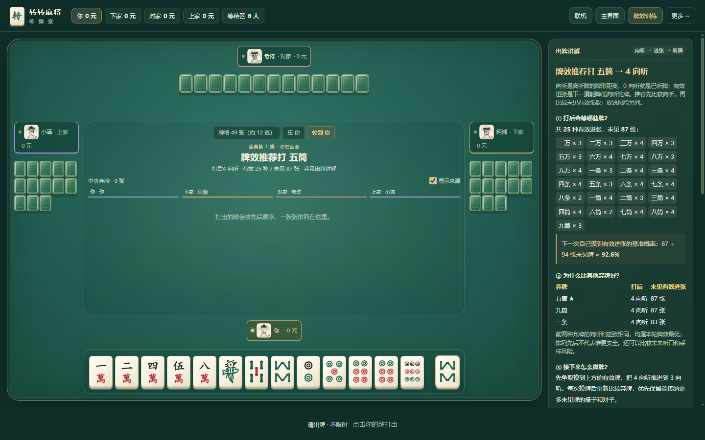
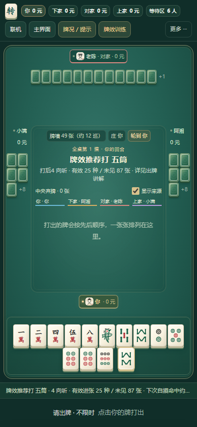

# 验证报告：牌友头像 / 原创背景音乐 / 教练短句（t4 独立验证）

- 任务：t4 — 验证牌友头像、背景音乐与教练文案
- 被验证实现：t3（attempt `54b468bd-04b0-486c-b540-4de38f22cde6`）
- 验证人：verifier（attempt `edf7b897-05ea-4fcc-98ce-634084a78795`）
- 验证日期：2026-11-04
- 结论：**PASS**。4 条契约验证命令、基线 82 项 Node、21 个浏览器作业全部退出码 0 / `ok:true`；t3 的 5 条验收均有可复现证据；未发现阻断性缺陷。记录 5 条低严重度问题与 4 条观察项，均不影响本轮交付判定。
- 实现未被本次验证修改：`index.html`、`tests/atmosphere.test.js`、`tests/run-checks.js` 的最后写入时间分别为 23:15:51、23:13:21、23:13:27，均早于本轮验证开始（23:25）；本轮只在 `reports/` 新增报告与 3 张截图，临时探针全部放在 `out/t4-tmp/`。

---

## 1. 环境与范围

| 项 | 值 |
|---|---|
| 项目根 | `D:\mahjong\repo` |
| 操作系统 / Shell | Windows，PowerShell 7（`pwsh`） |
| Node | v22.23.4 |
| 浏览器 | `C:\Program Files (x86)\Microsoft\Edge\Application\msedge.exe`（Edg/155.0.4283.62，headless=new；3D 抽查加 SwiftShader） |
| 版本控制 | repo 不是 git 仓库；改动范围用 `out/baseline-v33` 备份、文件哈希与行号交叉核对 |
| 被测实现 | `index.html`（441,682 B / 6,983 行）、`tests/atmosphere.test.js`、`tests/atmosphere-ui.html`、`tests/music-ui.html`、`tests/run-checks.js` |
| 未改动下游 | `server/`、`assets/`、`sw.js`（哈希与备份一致）、`docs/`；`BUILD='v33'`（t6 负责 v34） |
| 临时证据 | `D:\mahjong\out\t4-tmp\`（探针脚本与 JSON/日志），不属于交付物 |

验证原则：只读实现代码；不修改任何实现文件、测试文件或 sw.js；不安装依赖；不推送。

---

## 2. 验证命令与退出码

### 2.1 契约 verify 四项（全部 exit 0）

| # | 命令 | 退出码 | 关键输出 |
|---|---|---|---|
| 1 | `node tests/run-checks.js` | **0** | Node `# tests 99 / # pass 99 / # fail 0`；server `test-ws 9/0`、`test-rooms 16/0`、`test-online 10/0`；no-build 通过；smoke `冒烟测试通过`；末行 `全部检查通过。` |
| 2 | `node tests/run-checks.js --browser` | **0** | 21 个浏览器作业（20 个 pages-compat 页 + browser-online）全部 `"ok":true`，`"ok":false` 0 个；末行 `全部检查通过。` |
| 3 | `node tests/no-build-check.js` | **0** | `内联 script：3 个，外链：0 个`；`检查了 56 个 js 文件的依赖`；`sw 缓存：zmj-v33，资源 4 项`；`通过：页面自包含、零依赖、无构建步骤、离线资源齐全` |
| 4 | `node --test tests/atmosphere.test.js` | **0** | `# tests 17 / # pass 17 / # fail 0` |

### 2.2 补充回归与独立探针（全部 exit 0）

| 命令 | 退出码 | 关键输出 |
|---|---|---|
| `node --test tests/online-service.test.js tests/accounts.test.js tests/river.test.js tests/core.test.js tests/multi.test.js tests/training.test.js tests/decision.test.js tests/progress.test.js tests/lessons.test.js tests/settlement.test.js tests/server-limits.test.js tests/evaluation.test.js tests/connection-check.test.js tests/offline.test.js tests/personas.test.js tests/audio.test.js` | **0** | **基线 82**：`# tests 82 / # pass 82 / # fail 0` |
| `node D:\mahjong\out\t4-tmp\sig.js` | **0** | `omitted=25be8c97`、`explicitNull=25be8c97`；中性向量 `a5a86648/19/2/2/4/0` |
| `node D:\mahjong\out\t4-tmp\cdp-verify.js` | **0** | Edge CDP 真机探针：默认、1440×900、390×844、持久化、头像开关、隐藏、duck、TTS、教练、结算、sound=false |
| `node D:\mahjong\out\t4-tmp\cdp-wait.js` | **0** | 等待态 #coach 命中 wait 短句，四通道均未污染 |
| `node D:\mahjong\out\t4-tmp\cdp-3d.js` | **0** | 3D 牌桌 4 个头像、均 26px、无 `<b>`、无横向溢出 |
| `node D:\mahjong\out\t4-tmp\apk-copy-check.js` | **0** | 70 条对 5 个 APK 语音文件（2,720 行 / 544 唯一行）：整句 0、8 字片段 0、禁用词 0 |
| `node D:\mahjong\out\t4-tmp\coach-compare.js` | **0** | 实现 70 条与 t1 设计文档 70 条：id/文本逐字一致，0 差异 |
| `node D:\mahjong\out\t4-tmp\contrast.js` | **0** | 墨线 11.57:1；六主色 4.68–11.32:1；朱砂印 5.15:1（均对 `#f6efdf`） |

> 说明：`git diff --no-index` 在文件有差异时按设计返回 1，不列入验证命令；其输出只用于确认改动范围（见 §5.4）。

---

## 3. t3 五条验收逐条核对

### 3.1 A1 牌友头像 — **通过**

**实现证据**：`index.html:4271-4503`（Canvas 参数绘制、7 组加盐 FNV-1a、10 层线描、朱砂印、缓存/DPR/LOD/降级、`window.__zmjAvatar`）；`index.html:650-661` 尺寸 CSS；`index.html:6882-6890` 首页 36px 头像；设置开关 `index.html:5487,5519-5523,5556`。

**1440×900 实测**（`cdp-verify.js`，截图 `reports/screenshots/atmosphere-table-1440x900.png`，632,636 B）：

| 指标 | 实测 |
|---|---|
| `.seatAvatar` 数量 / 可见 | 4 / 4，均为 `CANVAS` |
| CSS 宽度 | 4 × 30px（`--seat-avatar:30px`） |
| `aria-hidden="true"` + `tabIndex=-1` | 4/4 |
| `.seatName` 数量 / 内 `<b>` | 4 / **0** |
| `scrollWidth` | 1440（无横向溢出） |
| 自己手牌 | 14 张，全部在 1440×900 屏内 |
| 默认头像开关 / 首页头像 | `on` / `#homeAvatar` 36px |

**390×844 实测**（截图 `reports/screenshots/atmosphere-table-390x844.png`，204,013 B）：

| 指标 | 实测 |
|---|---|
| 创建的 canvas / 可见 | 4 / **2**（#seat0、#seat2） |
| 侧家 `#seat1 .seatAvatar` | `display:none`（既有窄屏省略策略） |
| 可见头像宽度 | 2 × 16px |
| `.seatName` 行高 | **27px**（基线 24px，+3px，≤4px 预算） |
| `scrollWidth` | 390（无横向溢出） |
| 自己手牌 | 14 张全部在屏内；操作栏 787–844，完整可见 |

**设置持久化与关闭回归**（`independent-verify.json`）：

- 改设置后 `zmj_cfg_v2` 立即包含 `avatar:"off", music:"on", musicVolume:70, coach:"off"`；重载后读回 `setAvatar=off / setMusic=on / setMusicVolume=70 / setCoach=off`，4 个键全部按显式白名单恢复（`index.html:2682-2685`）。
- 头像 `off` 重载后：`.seatAvatar` 0 个、`#homeAvatar` 不存在；`.seatName` 仍 4 个；再切 `on` **即时**恢复 4 个 canvas，`.seatName b=0`。

**3D 抽查**（t3 报告列为未覆盖项，本轮补测）：3D 牌桌 `table3d=true`、WebGL 可用、4 个头像全部可见且均 26px、`.seatName b=0`、`scrollWidth=1440`。

**对比度**：墨线 `#24332c` 对纸色 `#f6efdf` = **11.57:1**；六个主色 4.68–11.32:1；朱砂印 5.15:1，均 ≥3:1。头像 `aria-hidden`、不加 Tab 焦点，名字仍以文本呈现，不靠颜色单独传达信息。

### 3.2 A2 背景音乐 — **通过**

**实现证据**：`index.html:3480-3762`（D 宫五声 72BPM 8 小节、三声部、calm/tense/settle、200ms 单定时器、`MUSIC_GAIN`、duck、隐藏停止、`__zmjMusic`）；总线顺序 `index.html:3260-3269`；启动点 `index.html:3077,3285,6315`；TTS duck 接线 `index.html:3335,3357,3364`。

**默认关 / 音量 40 / 总线 0.36**（1440 默认会话）：

```json
{"layer":"calm","running":false,"base":0.36000000000000004,"ducked":false,"notes":0,"muted":false}
musicTimers = 0
setAvatar=on, setMusic=off, setMusicVolume=40, setCoach=on
```

**开音乐 + 音量 70**（重载后真实 AudioContext）：

```json
{"running":true,"base":0.63,"notes":5,"timers":1}
musicGainNode=true, musicGainValue=0.6299999952316284
```

音量 0/100 的 0 / 0.9 映射、`linearRampToValueAtTime`、关闭停排程由 `music-ui` M3/M4 覆盖（`music-ui.html:158-180`），本探针复核了 70→0.63。

**页面隐藏静音 / 恢复不补播**：

| 时点 | running | timers | notes | starts | stops |
|---|---|---|---|---|---|
| 隐藏前 | true | 1 | 6 | 1 | 0 |
| 隐藏 250ms 后 | **false** | **0** | 6 | 1 | 1 |
| 继续隐藏 600ms | — | — | 6（**隐藏期间新增 0**） | — | — |
| 恢复 350ms 后 | true | 1 | 8 | **2** | 1 |

恢复后 `MUSIC.anchor` 重置为新时间、`MUSIC.next=0`（`index.html:3667-3670`），只从新小节继续，未补播隐藏期间音符。

**TTS ducking 真实路径**：

- 直接调用：`base=0.63 → duck(true,10)` 后 260ms `active=true, gain=0.2205`（=0.63×0.35），2.2s 后 `active=false, gain=0.63`。
- 真实报牌：`cfg.voice='key'` 时点击手牌，`speakAnnounce` 中 `duckMusic(true,len)`（`index.html:3357`）；`__zmjMusic.debug.ducks` 1→2，`ducked=true`，`#announce="你打一万"`；句尾 `onend→flushAnnounce→duckMusic(false)`（`index.html:3355,3364`）恢复。
- 隐藏/取消路径 `cancelAnnounce` 也调用 `duckMusic(false)`（`index.html:3335`）；另有 DUCK 兜底定时器（`index.html:3733-3736`）。

**总闸**：`sound=false + music=on` 重载后 `running=false, gainNode=false, timers=0, notes=0, muted=true`；`music-ui` M7 用桩进一步确认 `AudioContext` 创建 0 次（`music-ui.html:182-188`）。

**分层**：开局 `calm`；`drawsLeft≤4` 或副露≥3 → `tense`（`music-ui` M9 实测 `tense`）；结算 `settle` 并播 cadence（本探针快进后 `layer=settle`，`notes` 增加；`music-ui` M8 实测结算音符增加）。音乐代码段只读 `game.drawsLeft()`、`melds`、`H.over/result`，不读向听/进张/放铳（`atmosphere.test.js:149-154`）。

### 3.3 A3 教练短句 — **通过**

**实现证据**：`index.html:4859-4976`（70 条原创短句、5 类、纯函数 `coachPick`、`coachLine` 5 秒同类稳定）；落点 `index.html:4978-5038`；结算 `index.html:5351-5352,5384-5385`。

**5 类各 14 条、确定性**（真实页面 `__zmjCoach`）：

| 类 | 条数 | 40 个回合内不同 id | say:true |
|---|---|---|---|
| wait | 14 | 14 | 10 |
| wrong | 14 | 14 | 8 |
| risk | 14 | 14 | 12 |
| bird | 14 | 14 | 11 |
| review | 14 | 14 | 7 |
| 合计 | **70** | — | **48** |

同一 `(cat,handNo,turn)` 两次选取 id 相同；实现文本与 t1 设计文档 70 条逐字一致（0 差异）。

**落点实测**：

- **等待态**（无 feedback 的新局，独立探针）：`#coachMain = "别急着伸手，先看下家要不要这张。"`，命中 `wait` 文本；`#coach` 仍 3 个子节点；`#hint / #miniHint / #announce / #log` **均不含该句**；无启动错误。
- **反馈态**：打出一张后 `#coachMain` 显示 `wrong` 类 `E02「少算了进张，下次先数未见张。」`，原结论仍保留在 `#coachDetail`；风险句只在 `feedback.risk≥0.15` 时追加（`index.html:5024`）。
- **结算态**：快进到收炮局（鸟 6 只）并打开结算，`#settleCoach="记住这一手，比记住鸟数有用。"`（B14）、`#reviewCoach="这一手守得对，只是结果不理想。"`（V05）均存在；两节点各只出现一次。
- **考试模式**：`coachEnabled()` 要求 `learningMode!=='exam'`（`index.html:4955`），`training-release` 的测验隐藏答案断言全过。

**原创边界**：70 条对 5 个 APK 语音文件（2,720 行、544 唯一行）整句重合 **0**、8 字连续片段 **0**、禁用词 **0**；仅 13 处 1–3 字偶然同字（如“碰”“过”“开！”），与 t1 的 13 处结论一致。

**渠道安全**：`atmosphere.test.js:240-271` 静态断言 + 本探针运行时断言共同确认：教练短句不写 `#hint`、`#miniHint`、`#announce`、`#log`，不新增 `speak()`（全页仍 1 处），不破坏 `coach-advice` 的碰杠建议。

### 3.4 A4 单文件与兼容 — **通过**

- `index.html` 仍为单文件：441,682 B；3 个内联 script、0 外链、0 `require`、无 ``/`<audio>`/`data:image`/`data:audio`/音频扩展名。
- `tests/no-build-check.js` exit 0：3 内联 / 0 外链 / 56 js 内置依赖 / `zmj-v33` / 4 个离线资源齐全；`package.json`、`node_modules` 均不存在。
- `index.html:6842` 仍 `BUILD='v33'`；`sw.js` 与备份哈希一致（未提前升 v34，符合 t6 分工）。
- 引擎切片仍零浏览器 API：`atmosphere.test.js:273-282` 通过；服务端 `test-rooms.js` 16 项全过（引擎仍可被服务端抽取）。
- 默认牌谱签名：`sig.js` 输出 `omitted=25be8c97`、`explicitNull=25be8c97`，与冻结值一致；`personas.test.js:121-132` 通过。

### 3.5 A5 新增测试与接入 — **通过**

- 新增 `tests/atmosphere.test.js`（17 项）、`tests/atmosphere-ui.html`、`tests/music-ui.html`。
- `tests/run-checks.js:7` 增加 `atmosphere.test.js`；`:26-27` 增加 `atmosphere-ui`、`music-ui`（与原始 2,112 B 版本相比，仅这 3 处新增，无删除/弱化）。
- 全量 Node 99/0；浏览器 21 个作业全绿（19 个既有 + 2 个新增），逐页 `errors:[]`。

---

## 4. 关键运行证据

### 4.1 浏览器 21 个作业

`node tests/run-checks.js --browser` 日志（`out/t4-tmp/node-run-checks-browser.log`）解析：`"ok":true` **21**、`"ok":false` **0**、`"errors":[]` **21**、末行 `全部检查通过。`。

既有 19 项全部通过：`table-3d-ui`、`persona-ui`、`audio-ui`、`account-ui`、`connection-ui`、`table-layout`、`river-hover-ui`、`visual-ui`、`training-ui`、`training-release`、`lesson-ui`、`settlement-ui`、`selection-ui`、`online-response`、`worker-ui`、`coach-advice`、`reconnect`、`pages-compat`、`browser-online`；新增 2 项 `atmosphere-ui`、`music-ui` 也均为 `ok:true`。

`atmosphere-ui` 覆盖 P1–P11：4 个头像互不相同、`.seatName` 无 `<b>`、1440/390/844×390 无溢出、390 只显 2 个、关闭后 0 canvas、4 键持久化、重载恢复。`music-ui` 覆盖 M1–M9：默认静默、开启 0.36、隐藏停/恢复、duck≤0.126、音量 0/0.9、关闭停排程、sound=false contexts=0、`drawsLeft≤4→tense`、结算 settle+cadence。

### 4.2 截图

| 截图 | 路径 | 大小 | 内容 |
|---|---|---|---|
| 1440×900 | `reports/screenshots/atmosphere-table-1440x900.png` | 632,636 B | 四家头像 30px；自己 14 张手牌在屏内；侧栏讲解正常 |
| 390×844 | `reports/screenshots/atmosphere-table-390x844.png` | 204,013 B | 仅自己/对家头像 16px；侧家仅名字；14 张手牌两行在屏内；操作栏完整 |
| 设置面板 | `reports/screenshots/atmosphere-settings-1440x900.png` | 369,170 B | 新控件所在设置面板；头像行可见（音乐/教练行需下滚） |




### 4.3 独立探针 JSON

`D:\mahjong\out\t4-tmp\independent-verify.json` 保存了 `homeDefault / desktop1440 / mobile390 / persistenceWrite / persistenceReload / avatarToggle / visibility / duck / ttsDuck / coach / settlement / soundOff` 全部原始值；本报告的数字均来自该文件，可重跑 `node out/t4-tmp/cdp-verify.js` 复现。

---

## 5. 回归检查

### 5.1 默认牌谱签名 25be8c97 — **通过**

- `node out/t4-tmp/sig.js`：`omitted=25be8c97`、`explicitNull=25be8c97`；`personas.test.js` 的默认签名断言通过。
- 基线 82 项 Node 全部通过（含 personas/audio/core/decision/training/settlement/offline 等）。

### 5.2 基线 82 Node + 既有 19 浏览器页 — **通过**

- 基线 16 文件：82 pass / 0 fail，exit 0。
- 既有 19 个浏览器作业全部 `ok:true`；新增 2 个也通过。服务端 9/16/10 全过，无环境受限跳过。

### 5.3 `#hint / #coach / #miniHint` 与 `.seatName` 无 `<b>` — **通过**

- `#coach` 仍为三行结构；等待/反馈/结算的教练句均只在 `#coach`、`#settleCoach`、`#reviewCoach` 三个落点，`#hint/#miniHint/#announce/#log` 运行时均无该句。
- `atmosphere.test.js:240-256` 静态断言 + `audio.test.js` 的报牌渠道断言 + `coach-advice` 的碰杠建议断言全部通过。
- `.seatName b`：1440 探针 0、390 探针 0、3D 探针 0、`atmosphere-ui` 0；`.seatName` 数量始终 4（窄屏侧家也不例外）。

### 5.4 改动范围与锁定串 — **通过**

与 `out/baseline-v33/index.html`（404,020 B）相比：**+741 / −8 行**；8 条删除均可解释：

1. cfg 默认值行拆成两行以追加 4 个新键（`persona/voice/sfxVolume/voiceVolume` 连续子串原样保留）；
2. `SFX_GAIN` 声明行追加 `MUSIC_GAIN`；
3. TTS 无队列早退改为先 `duckMusic(false)` 再 return；
4. 反馈态 `#coach` 行拆分以追加 risk/wrong；
5. 等待态 `#coach` 行拆分以追加 wait；
6. 放铳风险计算只捕获 `riskProb`，原 `detail` 文案逐字不变，feedback 多一个 `risk` 字段；
7. 同上（两处调用点）；
8. hidden 监听扩展为 hidden 停止 + visible 重启。

11 条锁定串逐字存在：`persona: 'off', voice: 'off', sfxVolume: 100, voiceVolume: 80`、`['sfxVolume', 'voiceVolume']`、`u.onend = function`、`function sfxBus(a) { return SFX_GAIN || a.destination; }`、`SFX_GAIN.gain.value = Math.max(0, Math.min(1, cfg.sfxVolume / 100))`、`function unlockAudio() {`、`SFX_GAIN = AC.createGain()` 等；`tests/audio.test.js:138/141` 仍绿。

除 `run-checks.js` 外的 44 个既有测试文件哈希与备份逐字一致；`run-checks.js` 只增 1 个 Node 文件 + 2 个浏览器页（见 §3.5），没有删除或弱化既有测试（其备份件本身不是原件，见 F1）。

### 5.5 单文件 / 离线 — **通过**

3 个内联 script、0 外链、0 网络加载属性、0 `@import`/外部 `url()`、0 `require/import`、无 `package.json/node_modules`；sw 4 个离线资源都存在；`offline.test.js` 全部通过。首页 gzip 体积 133,746 B（smoke 输出），仍单文件可离线打开。

---

## 6. 发现与可疑项

> 无阻断性缺陷。以下按严重级别记录，均可复现；建议 t5 审查时确认是否接受或转后续轮次。

### F1（低）t3 的 baseline-v33 备份中 `run-checks.js` 不是改动前原件

- **问题**：`out/baseline-v33/tests/run-checks.js` 与当前 `repo/tests/run-checks.js` 哈希相同（2,227 B，已含 `atmosphere` 引用），而 `out/baseline-v33/run-checks.js`（2,112 B）才是真正的改动前原件。t3 报告称备份了“tests 45 个原文件”，对 `run-checks.js` 不成立。
- **复现**：`(Get-FileHash out\baseline-v33\tests\run-checks.js).Hash` 与 `repo\tests\run-checks.js` 相同；`out\baseline-v33\run-checks.js` 大小 2,112 B 且不含 atmosphere。
- **影响**：不影响当前功能/测试；但 t6 若用 `baseline-v33/tests` 做补丁 diff，会把 run-checks 的改动误判为“原有”。t6 契约已指定用 `mahjong-main.zip`，建议不要依赖该备份目录做基线。
- **相关行**：`out/baseline-v33/tests/run-checks.js` vs `out/baseline-v33/run-checks.js`；当前 `repo/tests/run-checks.js:7,26-27`。

### F2（低）单文件体积超出 t1 建议预算

- **问题**：`index.html` 404,020 → **441,682 B（+37,662 B）**，超过 t1 设计建议的“包体 +≤24 KB”约 13.4 KB（约 57%）。
- **复现**：`(Get-Item repo\index.html).Length`；`git diff --no-index --numstat out\baseline-v33\index.html repo\index.html` → `741 8`。
- **影响**：gzip 133,746 B，仍是单文件、零外链、离线可用；不影响验收命令。若后续还有 v35 功能，建议把教练文案/乐谱表改成更紧凑的编码或延迟初始化。
- **相关行**：`index.html:3480-3762`、`4859-4976`。

### F3（低）t3 报告中“19 条 >14 字”与实际 20 条不符

- **问题**：实现中正文长度 >14 字的短句实际 **20 条**（W01 W03 W08 W11 E01 E03 E08 E09 E12 R09 B06 B08 B10 V01 V02 V03 V05 V08 V12 V13），全部 `say:false`；t3 报告写 19 条。
- **复现**：`node out/t4-tmp/len-check.js`（或 `coach-compare.js` 输出 `rawLenOver14:20`）。
- **影响**：`atmosphere.test.js:178-210` 只要求总长 8–18、`say:true` 6–14，20/19 都满足；仅报告口径偏差，建议 t5 修正文字。
- **相关行**：`index.html:4860-4941`；`tests/atmosphere.test.js:200-210`。

### F4（低）联机结算不播 cadence，settle 分层只在单机触发

- **问题**：`tick()` 的联机分支在 `H.over` 时直接 `render(); showSettlement(); return;`（`index.html:3092-3095`），不会走到 `musicSettle(r)`（`index.html:3855-3861`）。联机结算时音乐继续按 calm/tense 播放，不切 `settle`、不播赢/输/荒庄短句。
- **复现**：联机打完一局，观察 `__zmjMusic.state().layer` 仍为 `calm`/`tense`；或静态读上述两处。
- **影响**：t3 已披露“联机结算不播 cadence”；不影响单机验收与所有测试。属于功能缺口，建议 t5 判定接受或 t6 后另开一轮补。
- **相关行**：`index.html:3092-3095`、`3855-3861`。

### F5（低）TTS `speak()` 抛错时 duck 不能立即释放

- **问题**：`speakAnnounce` 先 `duckMusic(true,len)`（`index.html:3357`）再 `s.speak(u)`（`:3358`）；若 `speak` 抛错，catch（`:3360`）只复位 TTS 状态，不调用 `duckMusic(false)`，音乐保持 0.35× 直到 DUCK 兜底定时器（1.2–6s，`:3733-3736`）。
- **复现**：stub `speechSynthesis.speak` 抛错 + 音乐开启，读 `__zmjMusic.state().ducked` 在异常后 1s 内仍为 true。
- **影响**：只在 TTS 异常时出现，最多压低数秒；不影响正常路径（正常 onend/flush/cancel 都会释放）。建议在 catch 里补一次 `duckMusic(false)`。
- **相关行**：`index.html:3343-3361`。

### 观察项（不判缺陷）

1. **风险类真实采样未构造**：`feedback.risk≥0.15` 的真实 UI 分支未在独立探针中稳定命中（本局采样风险 <0.15，显示的是 wrong 类）；纯函数与 `index.html:5024` 静态落点已覆盖，t3 也已披露。
2. **≥680 头像 16px 与 t2 写的 18px 不同**：实测 16px 使 390 行高 27px（+3px），满足 ≤4px 预算、无溢出；18px 会 +5px 超预算，t3 的降档选择合理，但应在文档中明确记为已接受 deviation。
3. **账号面板 72px 头像未做**：按 t2 C3 降为可选，不影响本轮验收。
4. **emoji 名字的印章字**：`avatarParams` 用 `chars.slice(0,1)`（`index.html:4294-4296`），可能截断代理对显示“�”；现有测试只要求空名/长名不抛错。属低概率视觉细节，建议未来用 `Array.from(chars)[0]`。

---

## 7. 未覆盖 / 限制

- 联机结算 cadence（F4）与真实风险采样（观察 1）未做端到端构造；代码与静态/纯函数证据已给出。
- 3D 头像本轮已补测 1440×900（4×26px），未测 390 竖屏 3D 下的 18px 档；`table-3d-ui` 的 390/844 用例仍全过。
- 未做长时间 CPU/内存曲线；音乐只有 1 个 200ms 定时器、每 tick 最多 4 个音符（`index.html:3644-3649`），静态上符合 t1 预算，但未做 30 分钟 soak。
- 未覆盖真实手机设备；390×844 用 Edge 设备指标模拟，键盘/触屏差异由既有 `selection-ui`/`visual-ui` 用例覆盖。

---

## 8. 复现命令块

```powershell
cd D:\mahjong\repo

# 契约四项
node tests/run-checks.js
node tests/run-checks.js --browser
node tests/no-build-check.js
node --test tests/atmosphere.test.js

# 基线 82（排除新增 atmosphere）
node --test tests/online-service.test.js tests/accounts.test.js tests/river.test.js tests/core.test.js tests/multi.test.js tests/training.test.js tests/decision.test.js tests/progress.test.js tests/lessons.test.js tests/settlement.test.js tests/server-limits.test.js tests/evaluation.test.js tests/connection-check.test.js tests/offline.test.js tests/personas.test.js tests/audio.test.js

# 默认签名
node D:\mahjong\out\t4-tmp\sig.js

# 独立真实浏览器探针（截图写到 repo/reports/screenshots）
node D:\mahjong\out\t4-tmp\cdp-verify.js
node D:\mahjong\out\t4-tmp\cdp-wait.js
node D:\mahjong\out\t4-tmp\cdp-3d.js

# 原创边界 / 文案一致性 / 对比度
node D:\mahjong\out\t4-tmp\apk-copy-check.js
node D:\mahjong\out\t4-tmp\coach-compare.js
node D:\mahjong\out\t4-tmp\contrast.js
```

日志：`D:\mahjong\out\t4-tmp\node-run-checks.log`、`node-run-checks-browser.log`、`baseline-82.log`、`atmosphere-test.log`、`no-build.log`、`cdp-verify.log`、`cdp-wait.log`、`cdp-3d.log`、`independent-verify.json`。

---

## 9. 最终判定

| 验收 | 结论 |
|---|---|
| 所有验证命令退出码 0 | **通过**（4/4，服务端无跳过） |
| t3 5 条验收逐条有证据；头像 1440/390 截图、持久化、关闭回归；音乐默认关/40/隐藏/duck；文案 5 类与落点 | **通过** |
| 回归：签名 25be8c97、基线 82 Node、19 既有浏览器页、`#hint/#coach/#miniHint`、`.seatName` 无 `<b>`、no-build 单文件 | **通过** |
| 可疑项有复现、行号、级别；不改实现；报告落盘 | **通过**（5 条低严重度 + 4 条观察项，无阻断） |

**PASS** —— 可进入 t5 代码审查 / t6 发布集成。
