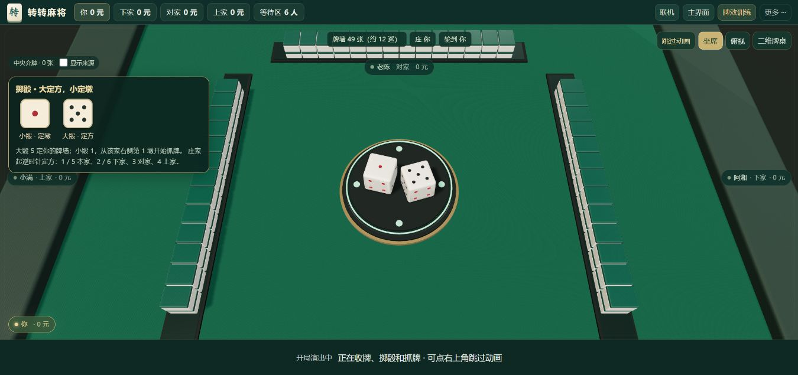
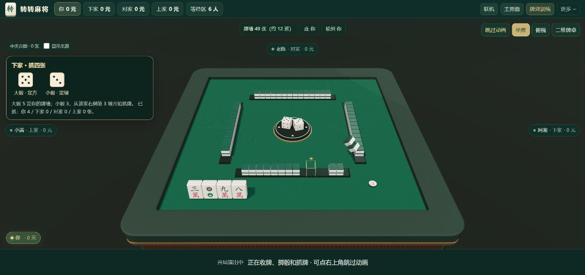
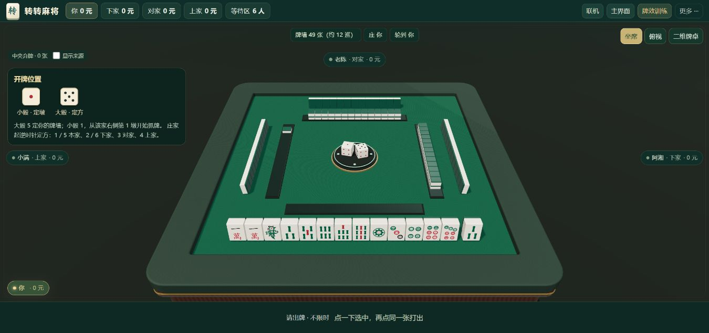

# 三维麻将试玩 · v31

日期：2026-10-19。v31。

## 打开与操作

- 在线体验：https://2653296079.github.io/mahjong/?build=v31&view=3d&play=1
- 双击根目录的 `试玩3D麻将.bat`：自动启动或复用 8192 预览入口。
- 直接试玩：http://127.0.0.1:8192/?build=v31&view=3d&play=1
- 首页「3D 试打一局」；已有牌局可在「更多」切换三维。
- 点一下抬起选中牌，再点同一张确认出牌；同种牌只选中实际点击的一张。
- 鼠标悬停、键盘聚焦、首次点选可看原有牌效分析；测验模式继续隐藏答案。
- 右上角切换坐席／俯视，拖动空白桌面略微调整坐席视角。
- 「二维牌桌」返回原视图，继续当前牌局；中央的「显示来源」切换各家弃牌边框。

## 已接入

27 种有实体牌面的麻将牌、绿色牌背、毡面木桌、两枚骰子和庄家标。自己的手牌立起、摸入张分隔；摸牌与出牌有动画，碰杠在各家位置、弃牌在中央逐张累积。开启系统减少动态效果时直接进入就绪桌面。

中央有升降骰盘和四方升牌槽。结算先看四家手牌，再点「收牌洗牌 · 下一局」：旧牌回收进机 → 机内洗牌 → 双层牌墙升起 → 中央掷骰 → 每家四张轮流抓三轮 → 庄家先取一张、隔一墩再取上层一张 → 其余三家各补一张。首次开局没有上一桌牌，直接从机内洗牌开始，正常帧率约 10 秒，续局约 11 秒；可随时跳过或切回二维继续本局。慢设备可能更久。

自己的四张抓牌从牌墙抬起后翻向玩家，按收到的顺序排在同一直线上；开牌结束再平滑理牌。其他玩家仍只显示牌背。牌面树脂增加柔和高光、接触阴影，桌毡和边框使用细微表面纹理，调整光照和环境反射；这仍是网页实时渲染和程序化演出。

### 骰点与接牌口

按用户指定的本桌约定，一次掷两骰：

- **较大点数定方**：庄家起逆时针数，1／5 抓本家牌墙，2／6 下家，3 对家，4 上家。
- **较小点数定墩**：从所选牌墙的右侧数第几墩；小骰为 1 就从第一墩开始，不再多跳一墩。
- 例如掷出 5 和 2：选庄家的牌墙，从右侧第二墩开始；掷出 3 和 1：选对家牌墙的右侧第一墩。相同点数分别承担定方、定墩两个作用。

骰子尺寸增大，掷骰时镜头拉近、停稳留出读点时间，面板以放大点阵分别标注「大骰 · 定方」「小骰 · 定墩」。金色方框和箭头、实际初始牌、后续摸牌使用同一个开口顺序，取墙沿顺时针推进。108 张共 54 墩，四方分别 14/13/14/13 墩；六张鸟牌保留在尾部。

这是本桌的明确约定，不代表所有地区规则。v30 的点数相加开口已替换；旧牌谱仍按记录的初始牌和事件回放。

以上为应用内浏览器实际画面，不是 Blender 效果图。

## 技术与验收

- 胡牌、记分、账号、联机逻辑复用；初始发牌和画面共用四张抓牌／庄家跳牌计划。自身牌面与公开牌使用模型，对手只传入暗牌数量。公开开牌数据只含规则标识、骰点、定方／定墩点数、开口家和起始槽位；本人的初始抓牌顺序放在私有字段，不发送其他人的暗牌或牌墙牌种。
- Three.js 0.180.0 的模块与许可证本地提供，首次启用约加载 4.7 MB 模型和引擎文件；不访问 CDN，无需 npm 构建。模型说明见 `assets/mahjong-3d/README.md`。
- 动态渲染按需运行；窗口隐藏、返回首页或打开弹窗时暂停。牌墙和对手牌背采用实例批量绘制，限制像素密度和阴影尺寸。
- 加载失败会回到二维。三维资源在访问后进入离线缓存；直接以 `file://` 打开请使用二维，三维请通过本机 HTTP 或网站 HTTPS 进入。
- 发布检查 `node tests/run-checks.js --browser` 全部通过：95 项规则／协议／服务端检查及 17 组浏览器流程。结果摘要见 `reports/v31-validation.md`，本机完整日志为 `reports/v31-release-check.log`。
- 开口检查覆盖全部 36 种骰点组合 × 四种庄位；另用 12 个种子 × 四种庄位独立核对真实抓牌顺序、庄家跳牌、尾部鸟牌与剩余墙。完整模拟还检查前方摸牌与杠后尾部补牌的物理张数守恒。
- 三维专项 33 条断言覆盖洗牌、升墙、骰子近景、自己的抓牌面、直线手牌、庄家先补到十四张及跳牌槽位，另含实际出牌、同种牌逐张选择、逐牌分析、二维切换、真实终局结算续局、跳过演出和手机横竖屏点击区。软件 WebGL 慢帧按可见进度播放，避免首次 shader 编译吞掉整段动画。
- 静态服务验证 GLB MIME 与精确路径放行，源 `.blend`、制作脚本和账号数据库不对外提供。

## 后续体验验收

桌面实景已检查；响应式自动检查只验证模型点击区，不代表真实手机流畅度。下一步以真实手机 GPU、长牌河可读性和三维多人同桌操作为验收重点，再决定是否增加音画细节、镜头和触感反馈。联机演出期间服务器可以继续推进，演出结束使用最新局面；中途加入旧局不重播开局。机内洗牌为程序化演出，发牌随机性由共享引擎决定，不依赖画面的刚体碰撞。
