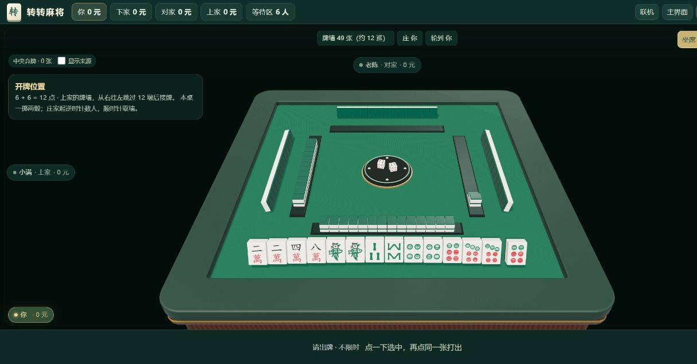

# 三维麻将试玩 · v30

日期：2026-10-18。v30 发布版本。

## 打开与操作

- 在线体验：https://2653296079.github.io/mahjong/?build=v30&view=3d&play=1
- 双击根目录的 `试玩3D麻将.bat`：自动启动或复用 8192 预览入口。
- 直接试玩：http://127.0.0.1:8192/?build=v30&view=3d&play=1
- 首页「3D 试打一局」；已有牌局可在「更多」切换三维。
- 点一下抬起选中牌，再点同一张确认出牌；同种牌只选中实际点击的一张。
- 鼠标悬停、键盘聚焦、首次点选可看原有牌效分析；测验模式继续隐藏答案。
- 右上角切换坐席／俯视，拖动空白桌面略微调整坐席视角。
- 「二维牌桌」返回原视图，继续当前牌局；中央的「显示来源」切换各家弃牌边框。

## 已接入

27 种有实体牌面的麻将牌、绿色牌背、毡面木桌、两枚骰子和庄家标。自己的手牌立起、摸入张分隔；摸牌与出牌有动画，碰杠在各家位置、弃牌在中央逐张累积。开启系统减少动态效果时直接进入就绪桌面。

中央新增升降骰盘和四方升牌槽。结算先看四家手牌，再点「收牌洗牌 · 下一局」：旧牌回收进机 → 机内洗牌 → 双层牌墙升起 → 中央掷骰 → 每家四张轮流抓牌 → 各补一张，庄家再摸一张。正常帧率约 7–8 秒，可随时点「跳过动画」或切回二维继续本局。首次开局没有上一桌牌，直接从机内洗牌开始。

### 骰点与接牌口

本桌选择一次掷两骰的约定：庄家为第一位，逆时针按总点数数到开口家；从该家右侧往左跳过总点数墩，在下一墩接牌，取墙沿顺时针推进。界面显示骰点算式、开口家、跳过墩数，并用金色方框和箭头标出接牌处。骰子落定的上面点数与文字一致，实际初始牌和后续摸牌也使用同一个开口顺序。108 张共 54 墩，四方分别 14/13/14/13 墩；六张鸟牌保留在尾部。

参考对照：[世界麻将组织《麻将竞赛规则》](https://www.mindmahjong.com/adobe/MCR2021.pdf) 使用两次掷骰流程。本项目的一掷约定在玩法规则中单独写明，不冒充竞赛双掷规则；也没有增加吃牌或字牌。

以上为应用内浏览器实际画面，不是 Blender 效果图。

## 技术与验收

- 胡牌、记分、账号、联机逻辑复用；初始发牌改为四张一抓。自身牌面与公开牌使用模型，对手只传入暗牌数量。公开开牌数据只含规则标识、骰点、点数、开口家、跳过墩数和起始槽位；不发送牌墙牌种和其他人的暗牌。
- Three.js 0.180.0 的模块与许可证本地提供，首次启用约加载 4.7 MB 模型和引擎文件；不访问 CDN，无需 npm 构建。模型说明见 `assets/mahjong-3d/README.md`。
- 动态渲染按需运行；窗口隐藏、返回首页或打开弹窗时暂停。牌墙和对手牌背采用实例批量绘制，限制像素密度和阴影尺寸。
- 加载失败会回到二维。三维资源在访问后进入离线缓存；直接以 `file://` 打开请使用二维，三维请通过本机 HTTP 或网站 HTTPS 进入。
- 本轮完整检查 `node tests/run-checks.js --browser`：93 项规则、协议、服务端检查及 17 组浏览器流程通过；随后新增的四家公开骰点一致性与字段隔离测试也通过，房间测试现为 14 项。
- 开牌参照检查覆盖 12 个种子、四种庄位，独立核对每家三轮四张、补牌、庄家首摸、尾部鸟牌与实际剩余墙。完整模拟还检查前方摸牌与杠后尾部补牌的物理张数守恒。
- 三维专项 28 条通过，覆盖洗牌、升墙、掷骰、逐家 4/8/12 张、补到 13/14 张、实际出牌、同种牌逐张选择、逐牌分析、二维切换、真实终局结算续局、跳过演出以及手机横竖屏点击区。实景检查了中央骰盘与收牌动画；软件 WebGL 的慢帧按可见进度播放，避免首次 shader 编译吞掉整段动画。
- 静态服务验证 GLB MIME 与精确路径放行，源 `.blend`、制作脚本和账号数据库不对外提供。

## 后续体验验收

桌面实景已检查；响应式自动检查只验证模型点击区，不代表真实手机流畅度。下一步以真实手机 GPU、长牌河可读性和三维多人同桌操作为验收重点，再决定是否增加音画细节、镜头和触感反馈。联机演出期间服务器可以继续推进，演出结束使用最新局面；中途加入旧局不重播开局。机内洗牌为程序化演出，发牌随机性由共享引擎决定，不依赖画面的刚体碰撞。
