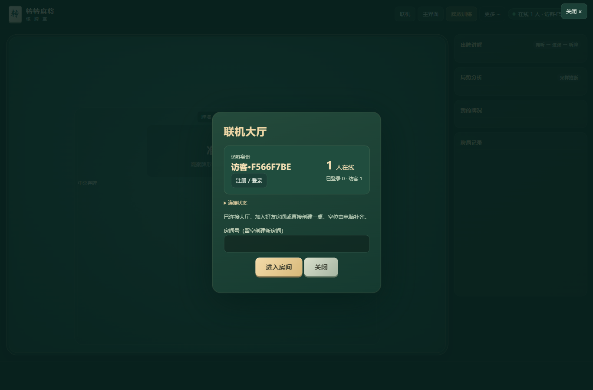
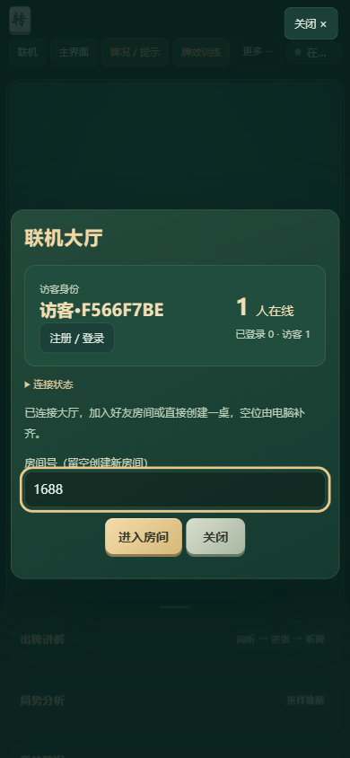

# 联机大厅与自动启动

## 玩家使用

打开统一的游戏网站，点「联机」进入大厅。无需配置 IP、端口或昵称。登录后显示数据库中的注册账号名；未登录显示自动分配的 `访客·编号`。可以直接注册／登录，再创建房间或填写好友的房间号。

大厅显示在线总人数、已登录账号数和访客数，实时更新。同账号多页面、同访客多连接各计一人；机器人和只发 ping 的诊断探针不计人数。统计的是已连接大厅或牌局的玩家，关闭所有连接后移除，不把离线房间人数当作在线人数。

## 运行入口

- 新入口：Windows 双击 `打开联机麻将.bat`。没有服务时自动后台启动，有服务时复用，然后打开联机大厅。
- 旧的 `启动手机服务器.bat` 转到同一个启动器，不再使用 Python 静态服务器回退。
- 既有 `公网联机-樱花frp.bat` 也复用此启动器。它继续使用原隧道配置，无需重新填写凭据。
- 默认端口 8000；开发者可运行 `node server/launcher.js 8191`。`--no-open` 只检查／启动、不打开浏览器。可用 `MAHJONG_PUBLIC_URL` 指定启动器打开的公开网址。

启动器校验健康接口中的应用标识，防止把任意占用端口的程序当成麻将服务；拒绝关闭其他服务。端口对应的文件锁防止重复点击启动多个入口。日志放在 `data/server-端口.log`，不进入仓库。

## 按需启动的实现

`server.js` 是持续在线的网页与账号入口。同一网址的第一次 WebSocket 连接会由 `OnlineService` 自动启动私有的 `game-service.js` 联机进程；多个同时到达的连接共享一次启动，随后直接复用。

私有进程只绑定回环地址上的临时端口，公开入口转发同一 `/ws`，保留原 Host、Origin 和 Cookie。玩家只使用一个公开网址。联机进程和入口共用 SQLite 文件；会话和完整对局仍然持久化，局中暗牌隔离继续生效。

联机进程异常退出后，下一次连接自动启动新进程。客户端会自动重连；检测到服务实例改变时，明确说明原局已中断并返回大厅，避免误建同号新局冒充恢复。中断存档保留但不计胜率。入口结束时通知私有进程退出，私有进程也监听父进程断开，避免遗留后台进程。

完整网页入口必须在线才能接收远程请求；网页不能在整台主机或入口都关闭时凭空启动远程电脑。主机端的双击启动器负责首次拉起／复用完整入口；长期公开服务仍由主机的服务管理器保证入口在线。

内存数据库 `:memory:` 仅保留单进程测试路径。正式部署使用持久 SQLite 文件，才能在入口与联机进程之间共享账号。

## 统一公网入口

`index.html` 的 `mahjong-online-url` 元信息目前采用用户此前提供的 `https://frp-way.com:20466/`。从 GitHub Pages 或离线文件选择联机时，转到这个统一网址；后续更换域名只需更新这一配置。账号与游戏在同一站点认证，不通过跨站 WebSocket 冒用注册身份。

从游戏服务器自身打开时优先连接当前站点，自动忽略旧的本机地址缓存；明确带 `server` 参数的邀请仍保留指定目标。URL 参数 `online=1` 可直接打开大厅，原房间邀请与复制链接继续可用。

新增公开 `GET /api/lobby` 汇总接口；首页通过该接口只读获取人数，不唤起联机进程。`/healthz` 增加 `app`、`build`、`gameService` 和在线汇总。均不公开 Cookie、账号 ID、名单或手牌。

## 验收

- `node --test tests/online-service.test.js`：真实 TCP 连接验证人数去重与身份、探针排除；验证按需启动、同时连接只启动一次、复用、崩溃重启、账号 Cookie 透传与中断记录；验证启动器并发复用、拒绝其他程序。
- 浏览器验收：自动连接并清理失效旧地址、无昵称／地址输入、同访客多连接计一人、房间号编辑不被推送清空、注册名与账号计数、出牌权威同步。
- 完整发布门禁：`node tests/run-checks.js --browser`。
- 本轮已在 1366×900 与 390×844 的真实浏览器中查看大厅并保存截图。确认两个旧入口没有进行中的房间后，更新了 8191 预览与 8000 隧道后端。公网 DNS／TLS 与不同网络的手机对局未在本轮重新验收。

