# 青玉练牌室 · 界面改版

日期：2026-10-17。对应《项目完善计划书》T06，以及本轮用户提出的画面优化。

## 参考与取舍

- [腾讯《欢乐麻将》官方 App Store 页面](https://apps.apple.com/cn/app/%E6%AC%A2%E4%B9%90%E9%BA%BB%E5%B0%86/id689180123)：核对产品与开发者，参考其中对不同玩法与好友对局的区分，作为本项目入口分组的依据之一。
- [《雀魂》官方入门指南](https://mahjongsoul.com/startguide/assets/jantama_startguide.pdf)：第 14 页说明手牌、摸入牌、动作按钮与双击同一张牌的操作。参考其将牌局状态和当前操作分开的思路。

青绿、象牙与暖金的配色是本项目自己的设计选择。大厅插画使用本项目已有 SVG 牌面组合，图标为内联线稿，未引入商业游戏的角色、背景或图标资源。

## 本次改动

| 区域 | 实现 | 目的 |
| --- | --- | --- |
| 大厅 | 新标记、标题、三张麻将插画；训练入口用浅色卡片突出；另列单机、联机与实际练习记录 | 初次进入能快速找到下一步 |
| 牌桌 | 青绿渐变桌面、细边框、较轻的中央提示、清楚的当前回合标签 | 将注意力留给手牌与操作 |
| 麻将牌 | 象牙牌面、绿底厚度、较短阴影；删除旧的逐牌噪声纹理绘制 | 提高牌面辨识度，减少画面杂乱 |
| 工具栏 | 练习、联机与回首页常驻；复盘、统计、规则、设置等放进“更多” | 减少顶部按钮拥挤 |
| 讲解与训练 | 统一面板、数字层级、公式块与表格；折叠备份及变式成绩说明 | 让题目和手牌更早进入视野 |
| 小屏幕 | 大厅卡片纵向排布、竖屏手牌换行、牌况底部抽屉；低高度横屏简化座位标签，以暗牌张数替代两侧拥挤的牌背 | 避免文字与手牌互相挤压 |
| 键盘操作 | 更多菜单支持 Escape、点击外部关闭；关闭设置返回可见菜单入口 | 防止焦点留在折叠内容中 |

主要颜色集中在 CSS 变量：桌面 `#236257`、背景 `#123f38`、暖金 `#e9c98d`、象牙 `#f6efdf`。动效继续遵循系统减少动画设置；不加载远程字体、图片或第三方脚本。

## 牌面重绘（2026-10-17）

根据用户对条子和筒子的反馈，重画整套图案：

- 条子使用连续竹身、暗色竹节和墨绿配色；二条上下分列两根，八条为上 W、下 M；一条为墨绿刻线、圆首红眼、双翼长尾的幺鸡。
- 筒子使用黑、绿、红三色套环；一筒为绿花红心，七筒上三点斜排、下四点方排，各牌按同一套中式实物牌核对配色。
- 万子采用黑色数字、红色“萬”字，五万的数字使用实物图中的“伍”。取消多层字影。
- 每个牌面都是独立 SVG，缩放时无位图模糊，也不再依赖页面上的共享渐变定义。图案以自绘路径组合；[布鲁克林博物馆的实物牌资料](https://www.brooklynmuseum.org/objects/164742)作为配色与排列的参考资料之一。
- 增加“更多 → 牌面一览”，一次查看 27 种牌及牌河中的小尺寸。浏览时不修改牌局，关闭后焦点回到可见菜单。

首次重绘的完整检查为 77 项规则／服务端测试、12 组浏览器流程通过；界面组扩至 32 条断言，缓存版本为 `zmj-v22`。

### 按同一套中式实物牌逐张核对

上一轮修正了二条与七筒，八条的上下方向仍画反。本次按用户指出的上 W、下 M 翻正，并实际查看了[中式实物牌图](https://shoplineimg.com/62be6a2cb8d408006a88ab73/671b04b7fe306100107ae182/900x.png)，逐张核对三门牌。统一采用该套实物牌的黑、绿、红配色与分组，万子为黑数红“萬”。

| 数值 | 条子 | 筒子 |
| --- | --- | --- |
| 一 | 墨绿刻线、圆首红眼、双翼长尾幺鸡 | 绿花、红心 |
| 二 | 上下两根绿竹 | 上黑、下绿 |
| 三 | 上一、下二，均绿 | 沿斜线依次为绿、红、黑 |
| 四 | 两行两列绿竹 | 四个绿圈 |
| 五 | 四角绿竹、中间红竹 | 四角绿圈、中间红圈 |
| 六 | 上三、下三，均绿 | 上二绿、下四红 |
| 七 | 顶端一红，下方两行各三绿 | 上三绿斜排、下四红方排 |
| 八 | 上 W、下 M，均绿 | 两列四行黑圈 |
| 九 | 三行三列，中列红、两侧绿 | 三排依次为黑、红、绿 |

二条竹身不被白色横线切断，避免误认六段；小尺寸预览包含二条、六条、八条及七筒，便于直接比较。

该轮通过界面布局 32 条、逐张选牌 11 条、训练交互 21 条浏览器断言，以及 3 项离线更新测试、自包含检查，缓存升级至 `zmj-v24`。

### 一条与七筒再校正（第九轮）

用户反馈一条仍不像、七筒排列有问题。本轮放大查看上面的中式实物牌图：一条采用圆首红眼、展开羽翼和下垂长尾的刻线造型，重新自绘 SVG，主色由整块黑身改为墨绿线条与象牙留白。[另一张一条实物近照](https://www.popdaily.com.tw/u/202008/480d47f4-4a45-4e54-aaa5-341c70205fd7.jpg)用于比较刻纹的线条与留白；本项目采用前述中式牌图的造型。

七筒上方三绿圈的斜率由约 41° 调整到约 20°；下方四红圈改为等横纵间距的正方阵。圆圈半径从 5.8 调整为 6.6，保留两组之间的空隙，避免原先斜排过陡、下方两排过挤的问题。

针对这两处修正，重新通过 32 条界面布局、11 条逐张选择、21 条训练交互浏览器断言、3 项离线更新测试和自包含检查。规则与推荐引擎逐字比较一致。实际查看桌面、390×844 竖屏及 20×27 小牌，更新下方截图，缓存升级至 `zmj-v25`。这次为自绘刻纹近似，不声称复刻某一厂牌；真实手机触感与不同设备显示仍需实机确认。

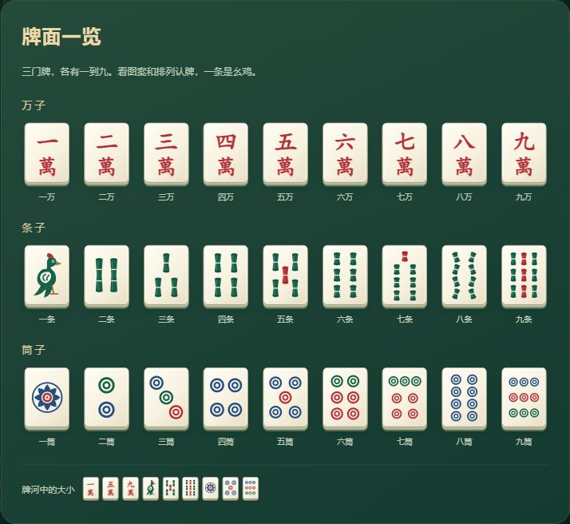

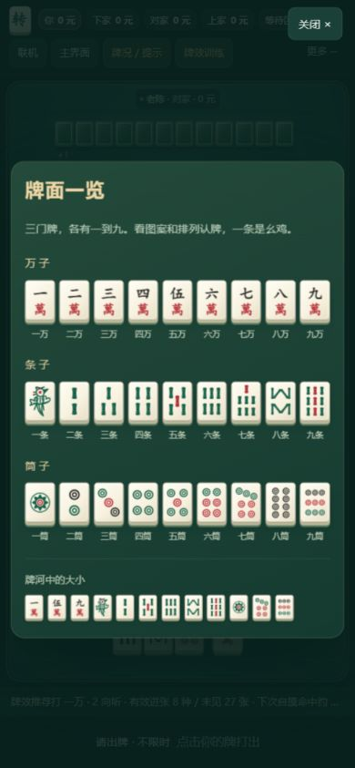

## 出牌后布局、中央牌河与逐张分析

用户截图中的牌河增高后挤掉中央高度，中央讲解、最新出牌和重复出牌文字溢出到座位标签。本轮限制上方牌区占用高度，中央按实际容器高度收紧；681–1040 宽窗口将讲解侧栏放入抽屉，左右暗牌改用张数；低高度横屏进一步收紧工具栏。

后续按用户反馈，把弃牌集中到中央，按真实出牌先后逐粒排布。四家分别采用蓝、金、珊瑚、紫色外壳，来源图例与座位边框一致；开关关闭后统一外壳，不改变万条筒的实物牌面颜色。被碰杠取走的牌不重复留在中央，底部说明数量。每家的副露仍放在自家座位，窄屏在所属区域内滚动，避免占用中央牌河。

逐张分析采用贴近手牌的象牙色浮层，尖角指向实际悬停的那一张牌。上方先显示打后向听、有效牌种和未见张数，再说明最优差距、下一摸概率、做牌路线和风险。高度随手牌上方可用空间收紧，内容可滚动，保持手牌可操作。鼠标离开关闭，手机首次选牌固定显示，键盘聚焦同样可查看，Escape 可关闭。测验和先判断模式不显示出牌前分析。

实际出牌验收覆盖 1460×1090、730×545、900×650、1366×768、390×844、844×390。逐张讲解及副露另有数值、交互和边界检查。下图通过实际 UI 操作产生，非设计稿：

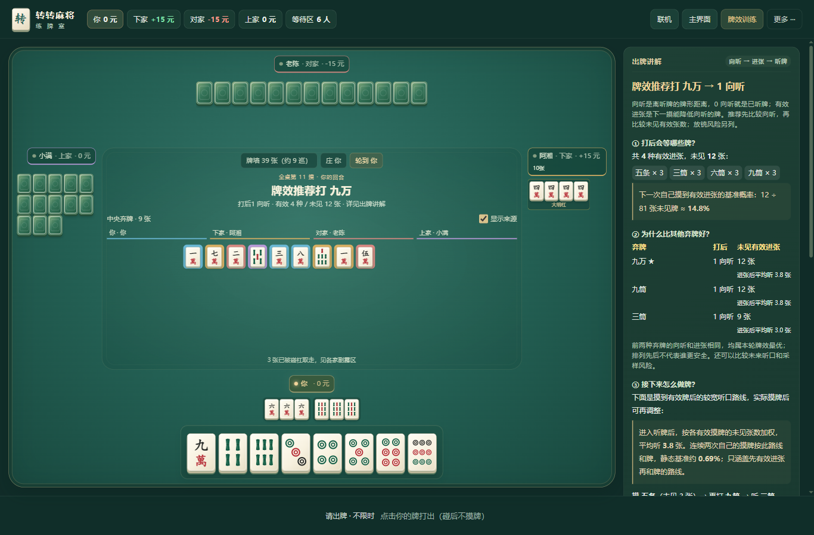

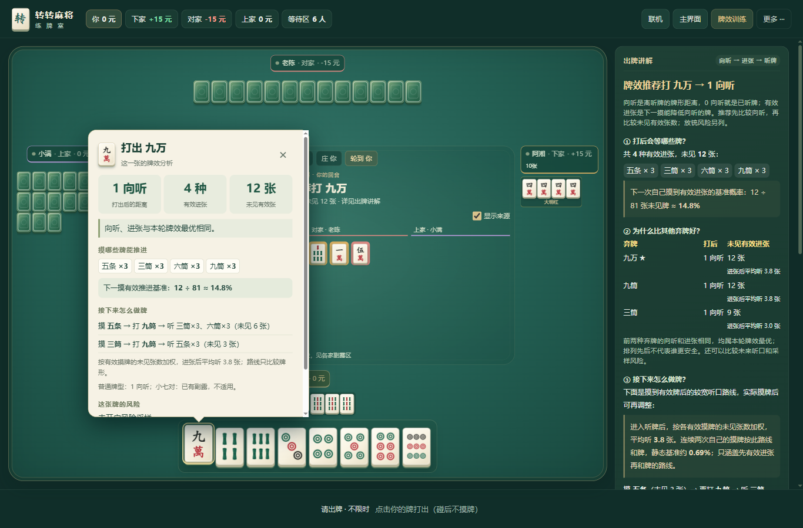

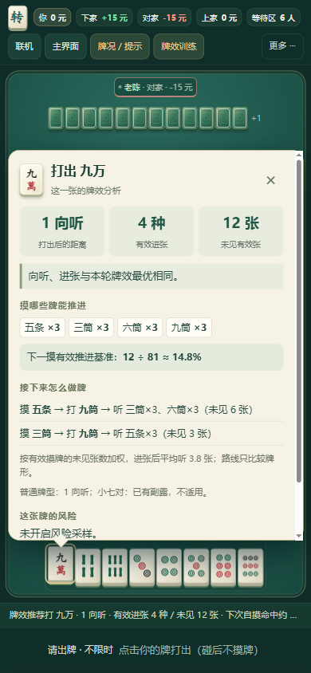

## 首轮布局验证与截图（8f53ad9）

下方保留首轮布局改版的验收记录与截图；最新牌面以上方为准。

完整命令：`node tests/run-checks.js --browser`。

- 46 项 Node、9 项协议、13 项房间、9 项真实 WebSocket 测试，共 77 项通过；自包含、零依赖与服务器冒烟通过。
- 12 组真实浏览器流程通过。新增界面组有 27 条断言，检查五种尺寸的入口、14 张手牌、菜单遮挡、焦点恢复及不误改牌局。
- 实际截图检查 1366×900 桌面、390×844 竖屏、844×390 横屏，并保存下方证据。尺寸模拟不能代替真实手机的系统栏、安全区与触感验收。
- 推荐计算、规则和联机协议没有调整。单张选择、后台采样、独立判断模式、重连和结算看三家牌均通过现有回归。
- 离线缓存升级为 `zmj-v21`。功能分支供审查；Pages 发布仍按《发布与回滚》执行。

### 桌面大厅

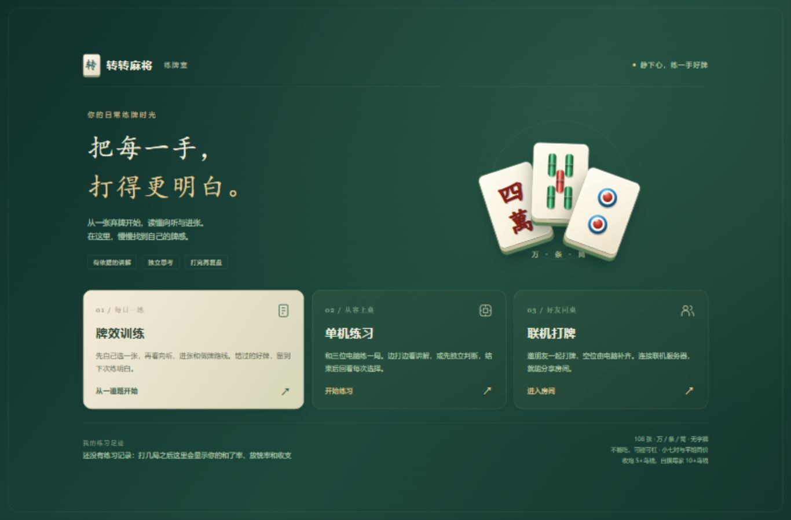

### 桌面牌桌

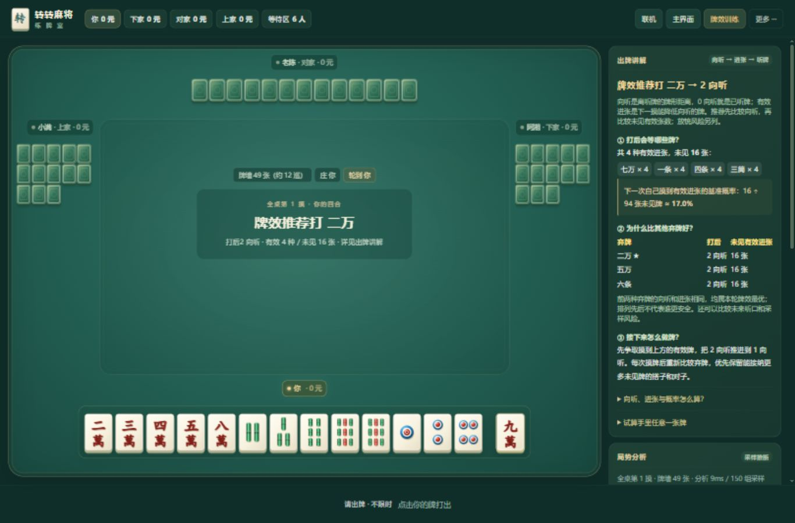

### 手机竖屏

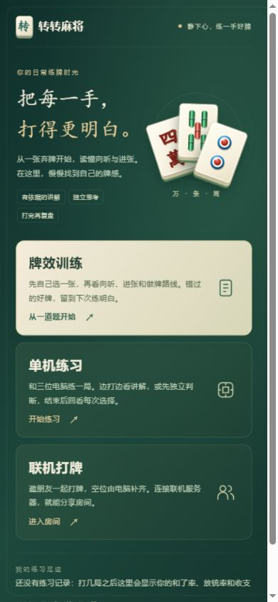

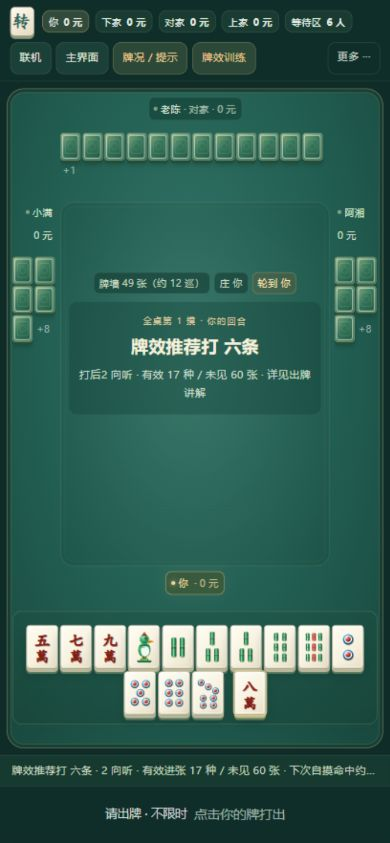

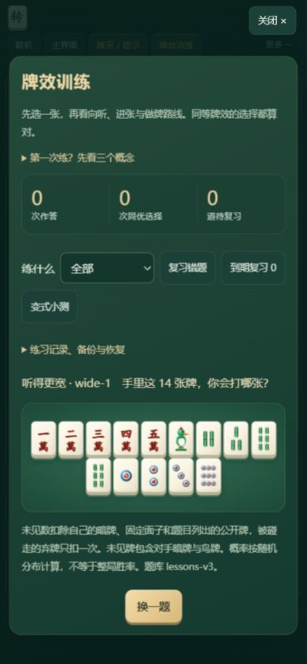

### 低高度横屏

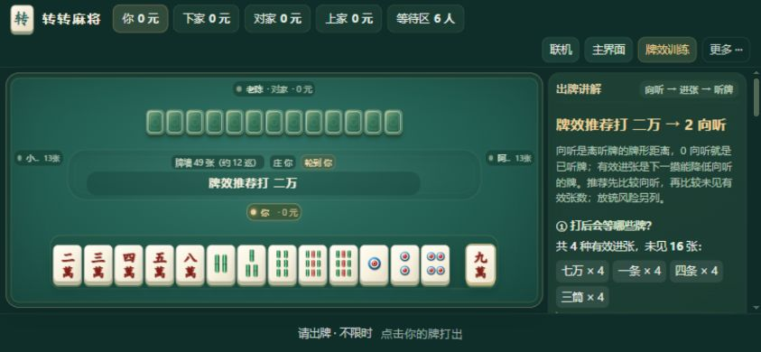

## 后续观察

下一步用实际玩家确认：能否快速找到训练、是否看得清手牌、能否找到更多菜单中的复盘，以及讲解侧栏的阅读负担。大型场景美术、角色和特效的投入应由这些反馈决定。
