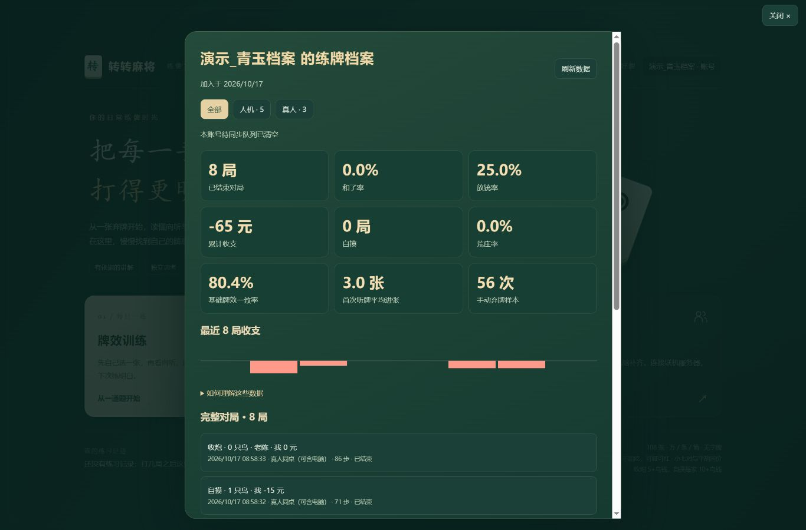
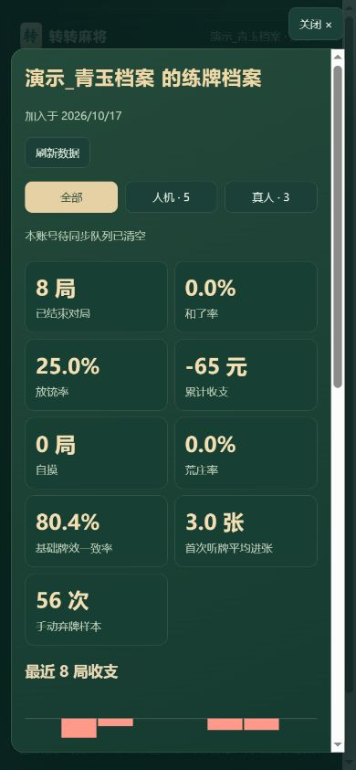

# 账号与完整对局存档

日期：2026-10-17。开发分支：`codex/mahjong-training-quality`。

## 使用流程

1. 从新版游戏服务器的地址打开页面，在首页点「登录 / 我的账号」，或在牌桌「更多」中进入账号。
2. 创建用户名和密码。用户名限 2–16 个汉字、字母、数字或下划线；去除首尾空白、统一全角字符、英文小写后，由数据库唯一约束防止同名，包含同时注册的情况。密码为 10–128 个字符。
3. 登录后新开对局。单机每次推进保存检查点，并自动同步完整终局；联机在服务器保存检查点和终局。已有游客牌局不自动追加入账。
4. 在账号面板筛选「全部 / 人机 / 真人」，查看战绩、最近收支和完整历史。点一局可以逐手回放、下载该局 JSON。

GitHub Pages 与离线文件支持游客练牌；账号需要从 Node 游戏服务器地址打开。不同服务器数据库可以独立，账号不会自动在任意服务器互通。仅在同一服务器注册一次即可换设备登录。当前没有邮箱、短信和忘记密码找回；可凭原密码修改密码，并撤销其他设备的登录。

## 保存的内容与归属

| 类型 | 保存与统计方式 |
| --- | --- |
| 单机人机 | 本机生成牌谱，IndexedDB 持久化待传队列，服务器按当前登录身份和开局归属检查后入库；来源明确为本机上传 |
| 联机人机 | 桌上只有一位真人，服务器保存牌谱 |
| 真人同桌 | 开局时桌上至少两位真人，允许电脑补位；不把等待区人数算作真人对手 |
| 进行中 | 联机只显示状态与公开摘要，不提供完整暗牌详情 |
| 中断／未完成 | 保存已发生的步骤，不计入胜率、放铳率和收支战绩；服务重启后中断记录可查看，但不恢复原房间继续打牌 |

保存四家起手牌、摸打事件、碰杠、鸟牌、结算及收支、规则与分析器版本、时间和座位；额外记录真人操作与托管标记。联机还保留服务器检查点中的剩余牌墙和终局手牌。服务端通过账号与座位关系归档，等待区不产生虚假参局记录。

单机的归属固定在开局时。退出或切换账号不会把这一局转给另一个账号；已登录的不同标签页共享 Cookie 时，上传端仍需核对开局账号，拒绝串号。断网记录只向原账号重试，同一局重复传输不重复计数；确认旧检查点时不会删除更新的待传版本。不要清除浏览器存储后再期望恢复尚未上传的本机记录。

## 数据面板口径

- 和了率、放铳率、荒庄率以本人上桌且已结束的对局数为分母。收支含杠钱，单位为游戏内记分。
- 人机包括单机和只有本人一位真人的联机桌。真人同桌包括真人和电脑混合桌；中途掉线托管仍属于原座位。
- 基础牌效一致率只比较手动弃牌：用决策当时的公开信息，先向听、再未见有效进张。不会按未来摸牌或对手暗牌打分。合理防守可能降低该比例，不能把它当成总实力或防守评分。
- 首次听牌平均进张，来自首次手动弃牌形成听牌的局面，采用当时未见有效张数；面板说明中列出具有该指标的对局样本数。未听牌与无手动样本不作为零进张。
- 最近 30 局展示逐局收支。新账号和空分类显示空状态；后台分析未完成时明确提示刷新，不以零冒充分析结果。

牌效分析在 Node Worker 中进行，存档不需要在出牌确认路径中执行整局分析。本轮只展示已有依据的统计，不把这些描述性数据包装成概率校准后的实力评级。

## 数据库与部署

使用 Node 内置 `node:sqlite`，无第三方包、无构建步骤。本次在 Node 22.16.0 验证，部署要求 Node 22.16 或更高；该版本可能打印 SQLite 实验性 API 提示。

- 默认文件：`data/mahjong.sqlite`，启动时创建目录和表。
- 可设置 `MAHJONG_DB_PATH` 为持久化文件绝对路径。测试可使用 `:memory:`，正式服务不要使用内存数据库。
- 表包含账号、散列登录会话、对局、账号座位关系和服务器实例标识；对局与参局关系在事务中写入。
- SQLite 使用 WAL。同机其他端口访问同一个数据库时，不会把仍在运行的服务器牌局误判为中断并开放暗牌。不同机器不应共享这一 SQLite 文件作为分布式房间服务。
- `data/` 与 SQLite 文件已忽略，HTTP 静态资源白名单也不允许下载数据库。代码提交不携带用户数据。
- 备份应先正常停服，再复制整个 `data/` 目录（包含可能存在的 WAL/SHM 文件）。使用自定义路径时备份对应目录。恢复前保留当前备份，不覆盖或删除现有用户数据。

公网仍应通过既有 HTTPS 入口打开。登录使用 HttpOnly、SameSite Cookie；同源 HTTPS 请求设置 Secure。密码用随机盐和 scrypt（N=131072、r=8、p=1）散列，不保存明文。写接口检查同源和自定义请求头，登录和注册限频，散列并发限制为两个；会话在退出、过期、修改密码后撤销。

实现参考：[Node SQLite 文档](https://nodejs.org/download/release/v22.17.0/docs/api/sqlite.html)、[OWASP 密码存储](https://cheatsheetseries.owasp.org/cheatsheets/Password_Storage_Cheat_Sheet.html)、[OWASP 会话管理](https://cheatsheetseries.owasp.org/cheatsheets/Session_Management_Cheat_Sheet.html)。

## 验收与截图

新增账号服务测试覆盖同名并发注册、密码与会话、幂等保存、历史隔离、数据库重启、后台牌效口径、共用数据库的活跃牌局保护、API 校验。浏览器验收覆盖注册、分类、回放、断网后刷新补传、切换账号、登录 WebSocket 身份及重连令牌隔离。

截图中的「演示_青玉档案」为独立演示数据库，通过 `node evaluation/account-demo.js` 自动模拟生成 5 局单机和 3 局真人座位流程，**不是用户真实战绩**。演示库为 `data/account-demo.sqlite`，不会写入正式账号库。

