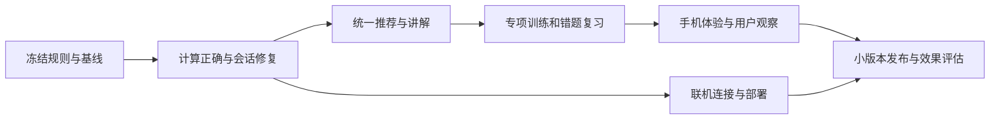

# 转转麻将练牌室｜项目完善计划书

日期：2026-10-16  
对象：项目负责人、后续开发者与测试者  
交付性质：调研、产品方案与实施流程；本文件不代表实施授权或上线确认。

> **建议目标：把项目做成一个能解释决策、帮助用户形成判断能力的转转麻将教练。**
>
> 最优先解决“算得对、讲得明白、练完有进步”。按“规则与算法 → 讲解 → 训练与复习 → 手机体验 → 联机与维护”的顺序迭代，每一阶段单独验收。

## 1. 现状、范围与交付边界

本计划基于本次检查的远端 `main` 提交 `2eb0fc5`、本地代码审查、已有测试，以及公开研究和官方文档。未确认 GitHub Pages 当前实际部署的提交，因此不将远端代码状态等同于线上状态。

现有项目已经具备：

- 108 张万、条、筒的转转麻将规则、电脑对局、碰杠胡与结算。
- 弃牌推荐、向听与进张讲解、对手手牌采样分析。
- 防守道场、牌谱回放、训练统计、离线缓存。
- 首页、联网房间、服务端牌局、电脑补位、掉线托管、等待区轮换。
- 核心规则、房间与 WebSocket 测试，以及浏览器测试脚本。

实现集中在 `index.html`，服务端在 `server/`；服务端从页面提取同一份规则引擎。无构建依赖、直接打开方便，是现有项目的优势；规则、界面和联机逻辑集中，也增加了修改时互相影响的风险。

**本地草稿说明：** 在用户明确要求“只做计划”之前，开发分支 `codex/mahjong-training-quality` 已产生部分未提交代码和测试草稿。它们没有提交、推送或上线，也没有完成整体验收。本计划不把草稿计入已交付成果。后续实施时，先审查并按任务拆分，再决定采用哪些改动；不要直接把整批草稿当成一个已完成版本合并。

## 2. 产品定位与判断项目是否变好的标准

### 2.1 服务谁

主要用户：会打转转麻将，但不熟悉向听、进张和做牌效率，希望知道“为什么打这张”的玩家。

次要用户：已经理解基本牌效，希望练宽听、碰杠取舍和攻守判断的玩家；偶尔与朋友联机的玩家。

### 2.2 用户应该能完成的四件事

1. 不看答案，判断当前最值得比较的两三种弃牌。
2. 看懂某张弃牌对向听、有效进张、未来听口的影响。
3. 区分“可以精确计算的数量”和“依赖模型的风险推断”。
4. 通过错题与相似新题，逐渐减少重复错误，并把判断带回完整牌局。

### 2.3 成功指标

| 维度 | 建议指标 | 解释与限制 |
| --- | --- | --- |
| 计算可信 | 已知规则案例全部通过；合法和牌、听牌与向听判断一致 | 是每次发布的硬条件 |
| 学会做牌 | 未见过的同类题中，向听损失和同向听进张损失下降 | 用独立测验题，不用反复做过的题证明进步 |
| 理解理由 | 用户能解释一次“为什么这个选择进张更多” | 小规模访谈比只看点击量更有用 |
| 使用顺畅 | 新用户能独立完成第一题并找到讲解 | 第一轮邀请 5–8 位目标用户观察；不当作统计显著性证明 |
| 运行可靠 | 关键流程无阻断；联机双方状态一致；训练记录可恢复 | 自动测试与真实设备体验都要做 |
| 性能 | 代表性手机上，基础推荐目标 P95 ≤ 200ms；复杂分析异步显示 | 这是待测的产品目标，不是当前已达到的数据 |

“和了率更高”“一局赚得更多”容易受运气、规则和对手影响，适合作为长期辅助指标。不要把“与推荐完全相同”当成唯一学习成绩，多种同优答案必须得到认可。

## 3. 调研结论：值得借鉴什么

| 调研对象 | 查证到的内容 | 对本项目的启发 |
| --- | --- | --- |
| [Euophrys Mahjong Efficiency Trainer](https://euophrys.itch.io/mahjong-efficiency-trainer) | 对不同弃牌比较能降低向听的牌数，错误选择后显示效率差异；支持载入手牌及多种练习设置 | 借鉴“作答后量化差异”、手动摆牌和针对性练习；按本项目规则重新计算答案 |
| [Mortal 官方文档](https://mortal.ekyu.moe/) | 开源的日麻深度强化学习 AI，提供相关在线服务入口 | 参考牌谱分析和决策评估的产品方向。规则不同，不能直接把其输出当成本桌标准答案 |
| [麻将缺张数研究](https://arxiv.org/abs/2108.06832) | 向听／缺张距离可以形式化计算；研究也考虑已知可用牌的信息 | 将规则、牌形距离和未见牌信息明确建模，建立正确性基准。论文中的距离定义和本项目“0 向听=听牌”的约定必须对齐 |
| [Let's Play Mahjong!](https://arxiv.org/abs/1903.03294) | 研究在若干次换牌内提高成牌概率的弃牌策略 | 推荐需要逐步从“一次进张”扩展到后续路线；即时进张最多不能被包装成整局绝对最优 |
| [Roediger 与 Karpicke 的检索练习研究](https://pubmed.ncbi.nlm.nih.gov/16507066/) | 主动作答可帮助长期保持学习内容 | 设计“先判断，再反馈，再复习”。把该结论用于麻将训练是产品推断，效果还需用本项目用户验证 |
| [W3C 弹窗交互指南](https://www.w3.org/WAI/ARIA/apg/patterns/dialog-modal/) | 弹窗应接管焦点，限制 Tab 范围，支持 Escape，并在关闭后恢复合理焦点 | 弹窗不能让用户输入文字时误触发牌桌快捷键；键盘和触屏都要可用 |
| [GitHub Pages 官方说明](https://docs.github.com/en/pages/getting-started-with-github-pages/what-is-github-pages) | Pages 提供静态站点托管 | 单机训练可继续使用 Pages；多人牌局需要独立运行的服务端 |
| [MDN WebSocket 客户端说明](https://developer.mozilla.org/en-US/docs/Web/API/WebSockets_API/Writing_WebSocket_client_applications) | 连接建立、消息和断线需要显式处理；HTTPS 场景应使用安全连接 | 把地址规范化、连接状态、重连与操作确认设计成完整流程 |

**适用范围：** 本项目采用转转麻将规则。参考日麻工具时，不能自动引入日麻振听、“打过这张就不会胡这张”、番种限制或不同的小七对四张计数规则。规则版本应出现在训练题与牌谱中。

## 4. 审查发现与优先级

下表描述本次检查的基线问题。部分已有本地修复草稿，仍应按下面的验收条件独立审查。

| 编号 | 问题与证据 | 影响 | 优先级与处理 |
| --- | --- | --- | --- |
| R01 | 普通牌型的拆分评分存在平局误选。例如 `2m456789m111444s` 已是四组面子加一张单牌，旧向听计算可报 1 | 已听牌却被当成未听牌，进张和推荐随之错误 | P0：修正规则评价，添加固定案例和批量合法牌型测试 |
| R02 | 规则允许四张同牌算两对；原小七对向听按每种最多一对计数。已和牌案例可显示 1 向听 | 小七对路线被系统性低估 | P0：和牌判断、向听和进张采用同一规则配置 |
| R03 | 碰牌建议没有完整枚举“碰后必须打出的一张牌” | 展示的进张不是最终留下的手牌进张 | P0：分别计算不碰与碰后所有合法弃牌，再展示后续弃牌 |
| R04 | 收炮提示与中央建议可能冲突；部分自摸概率以未见张数配牌墙长度计算 | 概率偏高，可能给出没有充分依据的“放过等自摸”建议 | P0：统一决策数据，重算概率并写清模型条件 |
| R05 | 较差向听候选的进张原先不计算，保留为 0；同向听同进张的另一选择也可能被当成不一致 | 比较与训练评分失真 | P1：需要展示时计算真实数值，区分不同阶段，接受同优答案 |
| R06 | 简易危险度使用“他家打过／碰过即安全”的逻辑；本桌没有相应日麻规则 | 防守依据与规则不匹配 | P0：移除绝对安全判断，重新定义规则内的风险模型 |
| R07 | 联机界面以 `isHuman` 判断是否显示自己的手牌；多人时可能将其他真人也当成自己 | 手牌区域和玩家身份显示错误 | P0：按当前连接的实际座位渲染 |
| R08 | 重连身份未完整撤销旧连接；昵称在若干位置拼接成 HTML | 旧页面可能继续影响座位，昵称可能被当成页面结构执行 | P0：会话唯一所有权、随机令牌、文本输出、输入校验 |
| R09 | 手动服务器地址缺少路径补全；邀请与刷新恢复流程不完整 | 看似填对地址仍连不上，朋友难以进入同一桌 | P1：地址校验、邀请包含服务器信息、标签页内座位恢复 |
| R10 | 弹窗快捷键、返回首页续局、手机提示展开等交互还缺统一约束 | 误操作或练习中断 | P1：统一界面状态与焦点管理，并实测手机 |
| R11 | 原“双浏览器联机”脚本没有强制两人进入同一房间，也没有把关键手牌数量设为失败条件 | 测试通过不等于同桌联机通过 | P0：按业务结果断言，修正测试再用于发布 |
| R12 | 碰杠胡提示测试依赖随机对局在时限内出现机会；缓存清理未限定本应用前缀 | 测试偶发失败，离线更新可能影响同源其他应用缓存 | P1：固定局面测试；缓存按应用和版本管理 |

`m=万、s=条、p=筒`。上述具体案例属于代码审查／本地测试发现，研究论文并不直接证明这些实现错误。

## 5. 推荐的实施顺序与每阶段出口

以下估时按一名熟悉 JavaScript 的开发者集中工作估算，只用于排优先级。包括实现和必要验证，不包含等待外部反馈、服务器采购或新增需求；遇到算法或网络问题应重新估算。

| 阶段 | 要交付什么 | 完成后才能进入下一阶段的条件 | 参考工作量 |
| --- | --- | --- | --- |
| 0：冻结规则与基线 | 一页规则说明、基线测试结果、问题清单、本地草稿审查决定 | 明确四张计七对、过胡、抢杠、轮换、赔付等；可复现旧问题 | 1–2 天 |
| 1：计算与身份正确 | 向听、有效牌、碰后弃牌、概率口径、联机会话修复 | P0 案例通过；公开信息边界测试通过；两位真人同桌完整对局通过 | 3–5 天 |
| 2：推荐讲解 | 统一建议模型、候选对比、试算任意弃牌、一向听到宽听路线 | 中央、侧栏、手机提示与复盘口径一致；可人工复核示例 | 3–4 天 |
| 3：训练与复习 | 入门课程、专项题、同优答案、错题本、独立测验题 | 完整完成“答题→讲解→复习→新题检验”，刷新后记录正确 | 3–5 天 |
| 4：手机与完整对局体验 | 简化首页、分层提示、触屏选择、暂停与续局、键盘可用 | 竖屏、横屏、键盘关键流程通过；目标用户能独立完成任务 | 2–4 天 |
| 5：联机与发布稳定 | 邀请、重连、协议约束、部署说明、离线更新与回滚流程 | 在两个不同网络完成真实对局；断线恢复符合约定；旧版缓存能升级 | 3–5 天 |
| 6：学习效果与模型校准 | 小规模用户观察、保留题评估、性能记录、下一轮优先级 | 知道用户哪里仍看不懂；有数据决定是否投入更复杂 AI | 2–3 天工作量，另留观察时间 |

推荐先交付阶段 0–2，形成一个“可信且能解释”的版本，再发布训练版。稳定服务版随后进行。整体可按约 4–6 周安排迭代，**无需等所有功能结束才让用户试用**。

依赖关系：



## 6. 怎样完善推荐算法与讲解

### 6.1 建立统一的决策数据

中央提示、侧栏、手机提示和复盘必须读取同一次分析的结构化结果。不要各自写一套“建议碰”“建议放过”的条件。

每个可打牌至少提供：

- 弃牌、打后向听、普通牌型与小七对分别的距离。
- 有效牌种类、每种未见张数、总有效张数、未见总张数。
- 是否与基础牌效首选同优；若不同，差在向听还是同向听的进张。
- 有效摸牌后的合法后续弃牌与听口。
- 风险分析是否开启、是否已完成、使用什么模型；模型分数与确定计算量分开命名。
- 规则版本、分析版本与局面标识，避免展示上一回合的数据。

基础排序先采用“向听更低，其次有效未见张数更多”。把它命名为“基础牌效推荐”。同分候选不因排列顺序被判错，也不自动成为“绝对安全”或“整局最优”。

### 6.2 把用户关心的概念讲明白

**向听：** 使用清晰约定：和牌为 -1，听牌为 0，一向听表示还有一次有效推进才能进入听牌。普通牌型与本桌小七对同时计算。碰杠后要按实际副露数计算。

**结构与剩余牌分开：** 结构上 0 向听，仍可能没有任何未见和牌张。显示“听牌，但未见有效张为 0”，不要把结构向听和考虑剩余牌后的可达性混为一谈。

**进张：** 只统计能降低向听的摸牌；已经听牌时统计能和牌的牌。每种牌最多四张，扣除自己的牌和公开牌；被碰走的弃牌在牌河与副露记录里只能扣一次。

**种类和张数：** 同时显示“2 种／未见 7 张”。不能把 7 张写成 7 种，也不能只比听几种而忽略剩余数量。

**概率：** 先显示容易核算的下一摸基准：

```text
U = 有效牌的未见张数
N = 所有未见牌的张数
下一次自己摸到有效牌的基准概率 = U / N
```

例如未见有效牌 7 张、未见总牌 94 张，下一摸基准约为 7.45%。`N` 包含对手暗牌、未摸牌及未公开鸟牌；不能把 `U` 当成确定在牌墙中的牌数，再除以牌墙长度。

如展示固定听口下 n 次摸牌至少命中一次的模型，应使用不放回抽样：

```text
P(至少命中一次) = 1 - C(N-U, n) / C(N, n)
```

条件必须紧邻结果：未见牌随机分布、听口固定、摸牌次数固定；没有计算对手提前胡牌、碰杠改变摸牌机会、后续改牌和对手策略。这是基准计算，不能命名为“真实整局胜率”。

### 6.3 “怎么做牌，让听的多”的实现流程

对一向听候选，计划按以下步骤分析：

1. 假设打出某张牌，列出所有降低向听的有效摸牌。
2. 对每种有效摸牌，枚举下一张合法弃牌。
3. 找出能够保持听牌的结果，逐一统计其未见和牌张。
4. 显示三条代表性路线，同时允许展开全部路线。
5. 按不同有效摸牌的未见张数加权，计算进入听牌后的平均听口。
6. 比较“现在容易进张”和“进张以后听得宽”的取舍，不只挑最好看的路线展示。

示例呈现结构：

```text
打 A：1 向听，未见有效牌 20 张。
其中摸到 X 后打 B，可听 8 张；摸到 Y 后打 C，只能听 3 张。
打 D：1 向听，未见有效牌 16 张，但进入听牌后的听口通常更宽。
```

这里的数字仅为界面示意，正式题目必须由具体合法牌型计算得出。

进阶阶段可增加两次自己摸牌的路线概率。它应覆盖说明中列出的路径，明确排除“第一摸没有降低向听但改善牌形”等未建模路径。不要把局部搜索结果称为完整最优策略。

更远的二至三向听先提供基础牌效与结构解释，待性能和正确性稳定后再扩展搜索深度。缓存键必须覆盖牌型、规则和相关公开信息；复杂搜索超时应返回已计算的基础结果。

### 6.4 碰、杠、胡的讲解

| 动作 | 应比较的内容 | 输出要求 |
| --- | --- | --- |
| 碰 | 不碰；碰后逐张弃牌的实际结果；小七对路线是否被放弃 | 明确“碰后打哪张”，显示最终向听与进张 |
| 暗杠／补杠／大明杠 | 即时杠分、牌形变化、补摸、公开信息与防守影响 | 不因有杠钱就固定推荐杠；区分规则可执行与策略值得执行 |
| 胡或过 | 已可获得的收益、过胡规则，以及等待时的竞争和风险 | 默认不凭简单概率鼓励放弃确定和牌；进阶建议需经过规则内模拟验证 |

### 6.5 对手风险模型单独发展

现有采样百分比需要被当成模型输出审查。增加采样次数只能减小抽样波动，不能修复错误的手牌先验或策略假设。

建议流程：固定一批完整模拟牌局 → 对评估器隐藏他家暗牌 → 只用公开信息预测 → 在评估端读取真实状态判断候选弃牌是否可被胡 → 按预测概率区间检查实际命中率。加入多种电脑风格和独立测试种子，避免只证明模型适合自己的单一对手。

校准前显示“采样风险估计”，不要用“安全率”作保证。模型与模拟环境差异、真实玩家分布差异仍需要说明。当前阶段不把未经校准的金额分数称为准确 EV。

## 7. 怎样建立有效的训练流程

### 7.1 建议课程顺序

| 级别 | 内容 | 作答任务 | 讲解重点 |
| --- | --- | --- | --- |
| 入门 | 面子、搭子、对子、将；0/1/2 向听 | 判断距离，找多余牌 | 先看全手，避免机械拆对子或边张 |
| 基础 | 同向听进张比较 | 从两三张候选中选择 | 逐种扣除已知牌，区分种类与张数 |
| 提高 | 两面、嵌张、边张、复合形 | 选择更宽听口的路线 | 展示下一摸、再弃牌和最终听张 |
| 专项 | 小七对与普通牌型转换 | 选择保留哪条路线 | 本桌四张计两对、碰牌后不能继续七对 |
| 决策 | 碰杠与不碰杠 | 选择动作及动作后的弃牌 | 不只显示当前动作带来的收益 |
| 实战 | 公开牌与攻守取舍 | 在明确目标下比较选择 | 基础牌效最优与风险更低可能不是同一张 |

### 7.2 一次完整练习

```text
选择主题 → 展示合法局面 → 用户先作答
→ 说明是否同优及差距 → 展示有效牌和后续路线
→ 用户用自己的话选出关键理由 → 保存需要复习的知识点
→ 稍后用相似但不同的牌型再考一次
```

每题先确定训练目标，例如“只比较进攻牌效”或“保留听牌同时比较风险”。不能用一个隐藏的综合分数判所有策略题的唯一正确答案。

讲解默认展开结论与最关键的一项差距，公式和所有路线放在可展开区域。新手不需要一次读完所有概率说明。

### 7.3 题库与错题

- 第一批建议 30–50 道经人工复核的核心题，覆盖每个知识点、同优答案、枯张、重叠拆分和副露。
- 每题保存规则版本、完整公开局面、题目目标、可接受答案集合、讲解要点与难度依据。
- 在固定题可靠后，再增加带约束的随机生成题。所有生成题检查张数、牌的上限、合法动作与答案一致性。
- 错题按原因分类：增加向听、损失进张、误数可用牌、忽略未来听口、碰后弃牌遗漏等。
- 原题用于纠错，相似新题用于检查是否掌握。熟记某一题答案不等于学会该知识点。
- 可先采用 1、3、7 天的复习间隔作为产品初始规则，之后按表现调整；这个具体间隔是产品方案，不声称是麻将学习的研究最优值。
- 练习记录优先保存在本机；提供导出和恢复，清空需明确说明范围。

### 7.4 与完整牌局连接

提供三个清楚的模式：

1. **带讲解练牌：** 出牌前可看推荐，适合理解。
2. **先判断后反馈：** 出牌前隐藏答案，出牌后解释，适合练习。
3. **整局测验：** 牌局中不提示，结算后只挑 3–5 个关键决策复盘。

复盘只使用当时能够看到的信息生成建议。结算后的真实暗牌可以作为单独的“揭晓”内容，不能混入当时推荐，否则会造成事后知道答案的假象。

## 8. 页面、手机和操作体验

首页建议保留三个主要入口：牌效训练、单机练牌、好友联机。已有未结束单机局时，突出“继续本局”。规则、设置和详细统计作为次级入口。

| 场景 | 建议体验 | 验收方式 |
| --- | --- | --- |
| 手机竖屏 | 手里的牌始终可辨认；主提示只显示一句结论；讲解用可展开面板 | 360、390、430 CSS 像素宽度检查横向溢出、遮挡和点击 |
| 手机横屏 | 留足出牌和动作按钮空间；顶栏减少重复信息 | 检查低高度屏幕、底部安全区和系统栏变化 |
| 触屏出牌 | 第一次点选并突出显示，第二次确认；说明这一规则 | 连续点击、误点旁边牌、转屏后选择状态检查 |
| 碰杠胡 | 动作区域位置稳定，显示来源和当前可选动作 | 一炮多响、多个杠选项、过胡限制案例 |
| 学习面板 | 局面和试算不混淆；“试算”明确不会真正出牌 | 用户能说清当前牌桌是否已发生变化 |
| 弹窗与键盘 | 焦点进入面板、Tab 不逃逸、Escape 关闭、关闭后可继续操作 | 输入名字／随机种子时 H/P/G/空格不能影响牌局 |
| 暂停与续局 | 单机查看讲解时暂停计时；回首页不自动重开 | 前后台切换、倒计时、返回首页及再次进入 |
| 联机暂停 | 打开自己的面板不能暂停所有人的服务器牌局 | 清楚显示服务器时限与托管状态 |

产品层面建议重要触控按钮目标尺寸约 44×44 CSS 像素，并提供明显焦点与文字状态。完整无障碍验收另按实际控件检查，不把单一尺寸当成“已完全符合 WCAG”。弹窗行为参考 [W3C 的官方模式](https://www.w3.org/WAI/ARIA/apg/patterns/dialog-modal/)。

视觉优化先解决层级、可读性、遮挡与误触；随后再统一牌面、间距、颜色和动画。牌面已有可用的内联 SVG，现阶段没有必要优先制作大量新美术资源。

## 9. 联机与部署的完善路线

### 9.1 先把一个房间做可靠

必须定义并测试以下状态：未连接、连接中、已连接未入房、房间等待、局中、等待上桌、重连中、被新页面接管、已退出。

计划处理：

- 输入 IP、HTTP 地址或 WebSocket 地址时统一转换、补全路径并给出可理解的失败原因。
- 邀请链接包含房间及必要的服务器地址；邀请、输入房号和房间列表进入结果一致。
- 同一连接重复点击入房不增加新成员；同一座位重连后旧连接失去控制权。
- 操作消息带有可校验的局面版本／请求标识，过期或重复操作被拒绝或幂等处理。
- 服务器验证动作类型、牌编号、座位权限和牌局阶段。
- 客户端只接收自己的暗牌；在等待区、结算、刷新和重连路径也验证这一点。
- 连接异常时展示当前状态；明确托管何时接手、重连后何时恢复控制。
- 公开服务部署前补充连接／消息／房间数量限制、异常输入处理及日志脱敏。

### 9.2 两种部署目标分开决策

| 方案 | 适用阶段 | 完善重点 |
| --- | --- | --- |
| 自己与熟人试玩 | 近期 | 保留局域网或穿透方式，提供一页启动与故障排查说明 |
| 稳定对外联机 | 确认有持续需求后 | 固定域名、HTTPS/WSS、进程管理、健康检查、日志与重启策略 |

GitHub Pages 可继续服务单机前端，但不能承担运行中的多人房间。稳定联机可以评估“一台小型主机运行 Node 服务，前面配置 HTTPS 反向代理”的方案；例如 Caddy 官方文档提供 [自动 HTTPS](https://caddyserver.com/docs/automatic-https) 和 [WebSocket 反向代理](https://caddyserver.com/docs/caddyfile/directives/reverse_proxy) 能力。

当前不预填未经核实的云厂商价格。选择服务器前，先明确预计同时在线人数、用户地区和可接受月度预算，再做价格与连接限制核验。

第一版稳定服务可以约定服务器重启后房间不恢复，但必须告诉用户并给出重新开局入口。只有当“恢复进行中的牌局”成为明确需求时，再增加服务端持久化与恢复测试。

## 10. 工程维护、验证与发布流程

### 10.1 逐步降低维护难度

短期保留可直接运行的方式，把规则计算、训练评分、分析结果和页面渲染的职责划清。避免为了换框架同时重写玩法、协议和全部界面。

中期评估将引擎、训练、联机、渲染拆成独立源文件。若仍需“下载一个 HTML 就能离线玩”，可通过发布打包生成单文件产物。是否引入构建流程应作为独立决定，不与规则修复捆绑。

建议记录格式统一带版本：规则版本、牌谱版本、分析器版本、题库版本。旧牌谱、旧统计和旧错题需要明确迁移或兼容策略。

### 10.2 验证矩阵

| 层级 | 必测内容 | 何时运行 |
| --- | --- | --- |
| 规则单测 | 普通和牌、四面子单钓、小七对含四张、副露、过胡、杠分与结算 | 每次规则改动 |
| 性质测试 | 每种牌最多四张、总牌守恒、收支零和、合法和牌对应 -1、移除可和牌后对应听牌 | 规则发布前 |
| 对照计算 | 自写慢速参照算法验证部分小状态空间；异规则开源库只比较规则相同子集 | 修改向听／有效牌算法后 |
| 信息边界 | 改变隐藏对手手牌，不影响同一公开局面的推荐；分析不修改牌局 | 每次分析器改动 |
| 讲解一致性 | 中央、侧栏、手机、复盘的向听与牌数一致；碰后必须含弃牌 | 每次讲解改动 |
| 学习流程 | 多个同优解、错题保存、复习完成、刷新恢复、版本变化 | 每次训练功能改动 |
| 联机集成 | 真正同房间的两位真人、掉线、旧连接、迟到加入、重复请求、等待区 | 每次网络／房间改动 |
| 页面与输入 | 真实浏览器、手机横竖屏、键盘、弹窗、输入框与触屏确认 | 每次交互改动 |
| 离线更新 | 首次缓存、离线打开、旧缓存升级、失败响应、同源其他应用缓存 | 每次发布机制改动 |

随机测试保存种子和失败局面；用户故事测试使用固定局面，不能靠“45 秒内恰好摸到能碰的牌”决定成败。测试应断言结果，例如双方房间相同、手牌显示正确，而不仅仅是页面没有抛异常。

### 10.3 每次迭代的固定流程

1. **写任务卡：** 一个用户问题、一个可复现场景、一个验收标准。
2. **先保留失败证据：** 旧版案例、局面或截图，说明为什么需要修改。
3. **在功能分支修改：** 尽量一项主题一个提交／PR，避免多位开发者同时改同一个大文件。
4. **验证相关范围：** 规则改动跑规则与相关玩法；纯视觉改动检查真实界面，避免无关测试堆积。
5. **审查具体结果：** 写清前后行为、验证、未覆盖部分和规则影响。
6. **预览并验收：** 使用预览地址检查关键流程，特别是手机和联机。
7. **发布：** 记录版本、更新缓存版本、验证线上资源与页面版本对应。
8. **发布后回看：** 收集误解、错误和性能数据；出现阻断时回退到已验证版本。

不同开发工具协作时，共用任务编号与规则文档；接手前先同步分支、确认工作区与未提交改动，再认领下一张任务卡。这样能减少“各自做了一版，最终规则和提示不一致”。

## 11. 可直接交给开发者的任务清单

| 任务 | 交付范围 | 依赖 | 验收结果 |
| --- | --- | --- | --- |
| T01 规则与基线 | 固定规则、复现 R01–R12、审查本地草稿 | 无 | 每个问题有案例或明确待验证项 |
| T02 向听与有效牌 | 普通拆分、小七对、公开牌扣数、同优判断 | T01 | 固定案例、合法牌型性质与对照测试通过 |
| T03 动作与概率口径 | 碰后弃牌、收炮建议、概率分母、风险命名 | T02 | 同一局面所有提示一致，可人工核算 |
| T04 多步讲解 | 候选对比、任意弃牌试算、有效进张到宽听路径 | T03 | 用户可跟着路线重建手牌并检查听口 |
| T05 学习闭环 | 主题题库、错因、复习、独立测验 | T04 | 原题纠错与新题迁移检验都可完成 |
| T06 手机与输入 | 竖屏、横屏、触屏确认、焦点、续局 | T04 | 代表性尺寸和真实设备无关键阻断 |
| T07 联机正确性 | 座位渲染、会话所有权、文本显示、动作校验 | T01 | 真同桌对局及重连测试通过 |
| T08 连接与邀请 | 地址、邀请、刷新恢复、错误提示 | T07 | 新用户从邀请进入同一桌，无需理解 WebSocket 路径 |
| T09 发布与恢复 | 离线缓存、版本、预览、回滚说明 | T06、T08 | 更新、离线和回滚演练通过 |
| T10 效果观察 | 目标用户任务、保留题、性能与风险校准报告 | T05、T09 | 下一轮投入由结果和用户反馈决定 |

任务卡示例：

```text
编号：T03-碰牌讲解
问题：建议碰牌时，没有算清碰后必须打出的牌。
用户目标：看懂碰与不碰分别会留下什么牌形。
交付：比较不碰与碰后所有合法弃牌，显示最佳后续弃牌及最终向听、进张。
验收：固定牌型可人工复核；计算前后真实牌局不变；两处提示使用同一份结果。
范围边界：本卡先解决牌效，不宣称完整攻守策略最优。
```

## 12. 首批版本范围与延后事项

**首批可信训练版：** 完成规则和牌效修复、统一讲解、宽听路线、基础专项题、同优评分、错题复习，以及必要的手机与输入修复。联机已经存在的身份和显示问题应同步修复，以免保留已知阻断。

**后续稳定服务版：** 完善公网联机、容量限制、重连、发布恢复和持续反馈。

**先保留为候选：** 更深的 AI 搜索、大模型自然语言教练、语音讲解、账号云同步、排行榜、好友系统和复杂美术升级。只有用户需求和学习数据支持时再投入。大模型若用于讲解，应根据已验证的结构化计算结果生成文字，不能凭空生成听张、概率和规则结论。

后续开始实施时的第一步是 **T01：确认规则、复现问题、审查已有本地草稿**。之后依次完成 T02、T03、T04，把“可信的推荐与解释”交付给用户，再进入更完整的训练体系。
